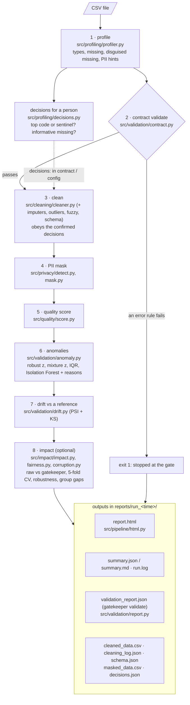
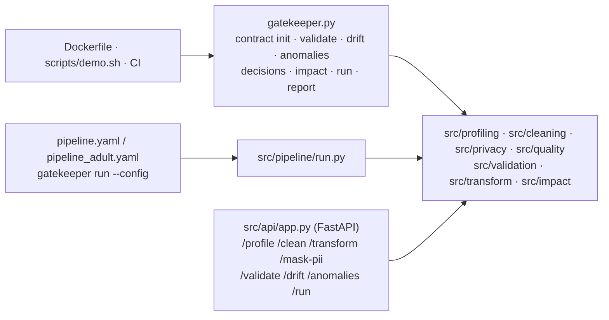

# Architecture — Data Gatekeeper v2.0

One CSV goes in; a person gets a clear answer (can this file be used?), a cleaned file, and one
readable page. Every step is an ordinary Python function in `src/`, reached through four doors
(CLI, pipeline YAML, HTTP API, Docker) that all call the same code.

## The flow of one run

The model-ready transform (`src/transform/plan.py`, `pipeline.py`: encoders, scalers, power transforms,
fitted on train rows only) is used by `run_transform.py`, `POST /transform` and inside the impact study.

## Entry points (the four doors)

| Door | Use it for | Example |
|---|---|---|
| CLI | one task at a time, in a terminal or CI | `python gatekeeper.py validate new.csv --contract contracts/bank_marketing.yaml` |
| Pipeline YAML | the whole flow with one command, gates, one report | `python gatekeeper.py run --config pipeline_adult.yaml --skip impact` |
| HTTP API | other programs; upload a file, get JSON or the page | `curl -F file=@data.csv -F config=@config.json http://127.0.0.1:8000/run` |
| Docker / demo | the same commands without a Python setup | `make demo` |

## Where things live

| Folder | What it does | Built in |
|---|---|---|
| `src/profiling/` | profile a file, semantic types, disguised missing, cleaning suggestions, decisions for a person, charts | Sprints 1–3, 11 |
| `src/quality/` | quality score 0–100 (completeness, uniqueness, validity, consistency) | Sprint 3, 6 |
| `src/cleaning/` | cleaning steps 1–12 (+ 8b for new rows), imputers (median, KNN, regression, MICE; fit/transform), outliers, fuzzy duplicates, schema | Sprints 4–5, 9–11 |
| `src/transform/` | per-column encoding, power transform, scaling; one scikit-learn pipeline fitted on train rows | Sprint 6, 12 |
| `src/privacy/` | find PII (9 types) and mask / hash / drop / generalise it | Sprint 6 |
| `src/validation/` | data contracts, drift (PSI + KS), anomalies, the combined validation report | Sprints 7, 9, 10 |
| `src/impact/` | does cleaning help a model? (A / B / C CV), corruption injectors, robustness, fairness measurement | Sprints 8, 11 |
| `src/pipeline/` | `gatekeeper run` (steps, gates, logging) and `report.html` | Sprints 8, 11 |
| `src/api/` | FastAPI app with upload limits | Sprints 2, 6, 9, 11 |
| `scripts/` | dataset downloads (checksums), demo, every evaluation and ablation behind a reported number | all |
| `contracts/` | data contracts and confirmed decisions (YAML) | Sprints 7, 10, 11 |
| `docs/` | sprint reports, presentations, JSON schemas, this page | all |

## Rules the design keeps
- **Fit on train rows only.** Every learned statistic (schema, imputer, scaler, forest) is fitted inside a fold
  or on a reference, then only applied to new rows. A test spies on every `fit()` in the impact study.
- **No raw personal data in any output.** Contract and drift reports mask PII values, anomalies never use PII
  columns, the HTML page shows only those reports, and logs hold names, counts and timings.
- **A person decides what only a person can know.** Uncertain codes are listed with evidence (`decisions`); the
  cleaner obeys the confirmed choice and logs who made it.
- **Exit codes mean one thing.** 0 = the data passed, 1 = the data failed a gate, 2 = a bad input or a crash.
