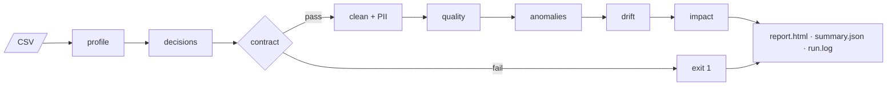

# Final Presentation — Data Gatekeeper

*CadetX AI Engineering & Data Science internship · 12 sprints · v2.0.0*

---

## Slide 1 — The problem
- Data that looks clean often isn't. The Bank Marketing file is **0% missing** to pandas, but **52,391 cells** are
  really missing, written as `unknown` or `999`.
- New files arrive every week and can be wrong in ways nobody notices: a renamed unit, an unknown code, a changed
  customer mix, a strange row.
- A model trained on that data fails **silently**.
- **Goal:** a gatekeeper that checks a file before anyone uses it, cleans it with every change logged, tells a person
  what only a person can decide, and **measures** whether all of this actually helps.

---

## Slide 2 — What Data Gatekeeper does
One CSV in → a clear answer, a cleaned file, and one page a non-technical reader can open.

| Step | Question it answers | Where |
|---|---|---|
| profile | what is in the file? (types, hidden missing values, duplicates, PII) | `src/profiling/` |
| decisions | which values can only a person judge? (top code or "no value"? informative "?") | `src/profiling/decisions.py` |
| contract | does it keep its promises? (pass / fail, exit code) | `src/validation/contract.py` |
| clean + PII | fix codes, duplicates and formats, fill gaps, protect personal data, log every change | `src/cleaning/`, `src/privacy/` |
| quality | a 0–100 score before and after (and why it is not model quality) | `src/quality/` |
| anomalies | which rows are unusual, and why? | `src/validation/anomaly.py` |
| drift | did the data move since the reference? | `src/validation/drift.py` |
| impact | does cleaning help a model? is it robust? fair? | `src/impact/` |
| report | one HTML page + JSON + logs | `src/pipeline/html.py` |

Four doors, same code: CLI (`gatekeeper.py`), `gatekeeper run --config pipeline.yaml`, the FastAPI app, Docker
(`make demo`). Architecture: `docs/architecture.md`.

---

## Slide 3 — Architecture

Rules the design keeps: everything learned is fitted on train rows only (a test spies on every `fit()`); no raw
personal data in any output; a person decides what only a person can know; exit codes are 0 = pass,
1 = the data failed, 2 = bad input.

---

## Slide 4 — Module 1: Profile (Sprints 1–3)
| Bank Marketing (41,188 × 21) | Result |
|---|---|
| Empty cells pandas sees | 0.0% |
| Hidden missing (`unknown`, `pdays = 999`) | **52,391 cells → 6.06% truly missing** |
| Duplicate rows | 12 |
| Quality score | 98.48 / 100 |
| Run time | 2.5 s |

Lesson: "0% missing" can be a lie, and a 999 is a code in one column and a real value in another.

---

## Slide 5 — Module 2: Clean (Sprints 4–6)
- 12 cleaning steps, every change logged with before → after examples; `pdays 999` becomes a flag, not an imputed number.
- ML imputation, measured: on Bank, iterative (MICE) NRMSE **0.478** vs median 1.063 (hidden 10% of known values).
- Model-ready transform fitted on train rows only; PII detection found **9 / 9** fake PII types and **0** in Bank.
- Honest quality score: Bank **98.48 → 98.60**, HR sample **88.87 → 99.83**. Flag columns no longer inflate it.

---

## Slide 6 — Module 3: Validate (Sprints 7–9)
- **Contracts + drift:** a shifted Bank file failed 2 contract rules, and drift was major on **exactly** the 3 changed
  columns (duration PSI 8.26, contact 0.58, age 0.31). Duration in whole minutes **passed** the contract, while drift
  still caught it.
- **Impact:** on Bank, cleaning gives **no ROC-AUC gain** (LogReg −0.0002, HGB +0.0001, CIs include 0); LogReg PR-AUC
  **+0.0197**.
- **Anomalies:** an Isolation Forest plus explanations (leave one column out); planted anomalies on real data are hard
  to find (best precision@k 0.21 in Sprint 9).

---

## Slide 7 — Module 4: Automate and finish (Sprints 10–12)
- **One command:** `gatekeeper run` (8 steps, gates, `summary.json`, `report.html`, `run.log`), `POST /run`,
  Docker, CI.
- **Second dataset (UCI Adult)**, decisions for a person, a fairness measurement, and the transform default decided
  by evidence.
- **`make demo`:** downloads both datasets with checksums and writes two reports in 287 s (locally; CI runs it inside Docker).
- **Tests:** 6 in Sprint 1 → **449** now; CI runs pytest, the contract gate and the Docker image on every push.

---

## Slide 8 — Honest finding 1: cleaning can HURT a model
- **UCI Adult, Sprint 10:** with the gatekeeper, both models got worse on every metric (ROC-AUC B − A: LogReg −0.0093,
  HGB −0.0053, CIs exclude 0).
- **Why (ablation):** `capital-gain = 99999` is a top code, and **all 244** of those rows earn `>50K`. `workclass = ?`
  means "no job reported" (9.47% vs 24.81% `>50K`). Imputing them erased real signal.
- **Fix:** **decisions for a person**. The detector lists such values with evidence, a person confirms them, and the
  cleaner obeys. HGB's gap is gone (−0.0002). The last LogReg gap came from the power transform (Sprint 12).
- **Independent check (Sprint 12, UCI Mushroom):** the detector found `stalk-root = ?` informative on one half of the
  rows (71.25% vs 39.04% poisonous), and the other half confirmed it (70.70% vs 37.34%).

---

## Slide 9 — Honest finding 2: quality score ≠ model quality
| UCI Adult | quality after cleaning | LogReg ROC-AUC B − A |
|---|---|---|
| default cleaning (Sprint 10) | **100.00** | −0.0093 (worse) |
| with the person's decisions (Sprint 11) | 99.80 | −0.0079 (less bad) |

A score counts what cleaning *changed*, not whether the change was right for the task. The HTML report now says
this next to every quality score.

---

## Slide 10 — Honest finding 3: the sentinel weakness, found and fixed
- **Found (Sprint 8):** under mixed corruption the gatekeeper made HGB **worse** than raw (0.6368 vs 0.6906 at 20%).
  Unseen `999`s stayed numbers, and the imputer filled gaps from them (72–74% of fills hit the clip edge).
- **Fixed in two steps, each measured with the same seed, folds and levels:**

| HGB, sentinels at 20% (ROC-AUC) | Sprint 8 | Sprint 9 (range rule) | Sprint 10 (frequency rule) |
|---|---|---|---|
| raw A: 0.8257 | 0.8264 | 0.8498 | **0.9141** |

- **What made it work:** the same robustness test that found the bug also proved the fix, and stopped a faster
  imputer from becoming the default in Sprint 11.

---

## Slide 11 — Fairness: a first measurement
UCI Adult, out-of-fold predictions, threshold 0.5. Measurement only; `sex` and `race` are used like any other
column.
- **HGB:** the cleaning leaves group gaps unchanged.
- **LogReg (Sprint 11):** the cleaning widened the TPR gap between women and men, 0.1055 → 0.1467.
- **Sprint 12, with skewed columns only scaled:** the LogReg gap with the gatekeeper is back to raw (0.1053 vs
  0.1055), and LogReg is no longer worse overall (ROC-AUC B − A −0.0002, CI includes 0).
- **Caveat:** different base rates (10.93% vs 30.38%) mean not every fairness measure can be equal at once.
  Nothing was mitigated.

---

## Slide 12 — Limitations
- Two main datasets (Bank, Adult) plus one detector check (Mushroom). Bank and Adult were each studied for several
  sprints, so some later decisions are informed by earlier results on the same data.
- The transform rule chose "scale only", which costs Bank's LogReg PR-AUC (−0.0191 from `duration`). A per-column
  rule might fit both datasets, but it was not written before measuring, so it was not used.
- The iterative imputer takes about 6 minutes per Adult fold; the faster setting failed the robustness gate.
- Anomaly detection on real data finds real oddities more than planted ones; the fairness check measures, it does not
  mitigate.
- Docker was not installed on the development machine: the image is built and run by CI on every push.

---

## Slide 13 — What I would do next
- A per-column transform rule (e.g. no power transform for zero-inflated columns), written first and tested on a
  third dataset.
- A faster imputer that keeps a model for every column, with the same two gates (accuracy and robustness).
- Decisions in the HTML report that a person can confirm with one click, saved back into the contract.
- A fairness check with mitigation options, and more datasets for the decision detector.

---

## Slide 14 — What I learned
1. **Measure the claim, not the feature.** "Cleaning helps" was true for robustness, neutral for clean Bank, and
   false for Adult until a person decided two values.
2. **Write the rule before the result.** The key thresholds of Sprints 9–12 (anomaly settings, the sentinel frequency
   rule, the decision rule, the imputer and transform rules) were committed before their first run. Once, a rule's
   winner (the faster imputer) was overruled by a second measurement, and the report says so openly.
3. **A second dataset finds bugs the first one hides.** Adult exposed an ordinal order wiping out a column, a top code
   read as a sentinel, and decisions silently dropped by the pipeline.
4. **Robustness tests are the best bug detectors.** Corrupting data on purpose found the sentinel weakness and
   stopped a "faster" default.
5. **A person must stay in the loop.** Some values mean something only a person knows; the tool's job is to show the
   evidence and obey the decision.
