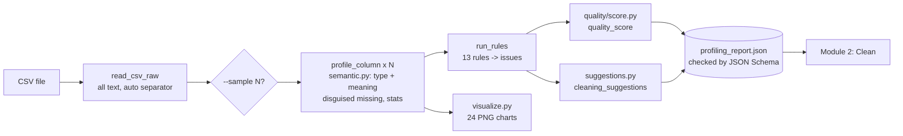

# Module 1 Presentation — Data Profiling & Metadata Intelligence

*Data Gatekeeper · CadetX AI Engineering & Data Science internship · Sprints 1–3*

---

## Slide 1 — The problem
- Bad data quietly breaks dashboards and ML models.
- "Messy" is often **invisible**: the Bank Marketing dataset looks **0% missing** to pandas…
- …but **52,391 cells** are really missing, written as `unknown` or `999`.
- **Goal of Module 1:** before anyone cleans or uses a dataset, describe it honestly and list what to fix.

---

## Slide 2 — What Module 1 does
Input: any CSV. Output: `profiling_report.json` + charts.

| Question | Answer in the report |
|---|---|
| What is each column? | type (numeric, date, category, text) + meaning (email, phone, ID, credit card…) |
| What is missing? | empty **and disguised** missing (`unknown`, `n/a`, `?`, `999`, `-1`) |
| What looks wrong? | duplicates, outliers, mixed types, inconsistent formats, suspicious columns |
| Is there personal data? | PII detection (email, phone, card with Luhn check, IP, date of birth) |
| How good is it overall? | **quality score 0–100** in 4 dimensions |
| What should we do? | **cleaning suggestions** with action codes → input for Module 2 |

---

## Slide 3 — Architecture

Same core function behind 3 doors: **CLI** (`run_profiling.py`), **Python** (`profile_file()`), **HTTP API** (FastAPI `POST /profile`).

---

## Slide 4 — How to run it
```bash
# CLI (full file, or a random sample for big files)
python run_profiling.py --input data/raw/bank_marketing.csv --output results/bank
python run_profiling.py --input data/raw/bank_marketing.csv --output results/quick --sample 5000

# API
uvicorn src.api.profiling_api:app --reload            # docs at http://127.0.0.1:8000/docs
curl -F "file=@data/raw/bank_marketing_sample.csv" http://127.0.0.1:8000/profile

# Tests
pytest -q                                             # 70 passed
```

---

## Slide 5 — Results: UCI Bank Marketing (41,188 rows × 21 columns)
| Metric | Result |
|---|---|
| Empty cells (pandas) | **0.0%** |
| Disguised missing cells | **52,391** → **true missing 6.06%** |
| Worst columns | `pdays = 999` **96.32%** · `default = unknown` **20.87%** · `education` 4.20% · `housing`/`loan` 2.40% · `job` 0.80% · `marital` 0.19% |
| Duplicate rows | **12** |
| PII columns | **none** (correct: the data is anonymised) |
| Issues | **13** (2 high, 11 medium) → 13 cleaning suggestions |
| Strong correlations | `emp.var.rate`–`euribor3m` r = 0.97, `euribor3m`–`nr.employed` 0.95 |
| Target `y` | imbalanced: 11.27% yes |
| **Quality score** | **98.48 / 100** — completeness 93.94 · uniqueness 99.97 · validity 100 · consistency 100 |
| Run time | **2.5 s** profiling, **3.5 s** with all charts (Sprint 2: 5.1 s profiling only) |

---

## Slide 6 — Charts to show (`results/bank/charts/`)
1. **`bar_default.png`**: `unknown` (orange) = 8,597 rows, more than 2,800 times the 3 `yes` rows.
2. **`hist_pdays.png`**: the real distribution (0–27 days) once the 39,673 `999`s are removed.
3. **`missing_heatmap.png`**: completely blank. That is the point: the classic chart says "no missing data".
4. **`correlation_heatmap.png`**: the economic indicators move together (one signal, not five).
5. **`outlier_distribution.png`**: `duration` and `campaign` have long tails.

---

## Slide 7 — From problems to actions (hand-off to Module 2)
| Column | Problem | Suggested action |
|---|---|---|
| `pdays` | 96.32% = `999` | `replace_with_nan_and_add_flag` (too much to fill in) |
| `<dataset>` | 12 duplicates | `drop_duplicates` |
| `default`, `education`, `job`, … (6) | `unknown` | `replace_with_nan_then_impute_mode` |
| `age`, `duration`, `campaign`, `pdays`, `cons.conf.idx` | outliers | `cap_outliers` |

Module 2 reads these codes, cleans the file, profiles it again and reports the **quality delta** (`quality_delta(before, after)`).

---

## Slide 8 — What I learned
1. **"0% missing" can be a lie.** Missing data hides as `unknown` and magic numbers like `999`.
2. **Context matters for sentinels.** `999` is a code in `pdays` (values 0–27) but a real value in a salary column, so the rule checks the gap.
3. **Statistics have blind spots.** With IQR = 0, every non-zero value looked like an outlier, and `pdays` had a fake mean of 962.
4. **Vectorise before you optimise.** One pandas call per column instead of 865,000 per-value calls halved the run time.
5. **A schema is a contract.** Module 2 can trust the report, and a test keeps code and schema in sync.

---

## Slide 9 — Next steps: Module 2 (Clean), Sprints 4–6
- Sprint 4: read `cleaning_suggestions` → fix types, trim/lowercase, drop duplicates, write `cleaning_log.json`
- Sprint 5: replace disguised missing with NaN, impute (median/mode), cap outliers, ISO dates
- Sprint 6: mask PII, profile the cleaned data again → **before/after quality score**
- Target: raise the bank quality score from **98.48** to ~100, with every change logged.
