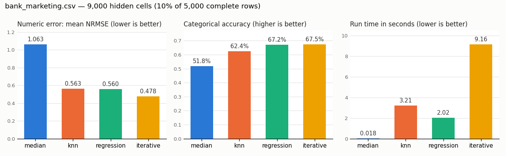

# Module 2 — Cleaning & Transformation (Sprint 4: core pipeline · Sprint 5: ML cleaning)

## What it does
Takes a raw CSV and its Module 1 `profiling_report.json` and produces:

| Output | What is in it |
|---|---|
| `cleaned_data.csv` | the cleaned data (comma separated, dates `YYYY-MM-DD`, empty cell = missing) |
| `cleaning_log.json` | every change: step, column, rule, how many cells/rows, before → after examples, summary, quality score before → after |
| `schema.json` | what every column **should** look like: type, ranges, allowed values, format (for Module 3) |
| `imputer_evaluation.json` + `.png` | only with `--evaluate-imputers`: every imputer scored on hidden known values |

The raw input file is **only read, never written**. The CLI refuses an `--output` that would overwrite it.

```
raw.csv ─► Module 1 ─► profiling_report.json ─┐
   │                    (cleaning_suggestions) │
   └──────────────────────────────────────────►┴─► infer_schema ─► 12 cleaning steps ─► cleaned_data.csv
                                                                                    ├─► cleaning_log.json
                         profile cleaned_data.csv again (quality AFTER, schema) ────┴─► schema.json
```

## How to run it
```bash
# with a profiling report you already have
python run_profiling.py --input data/raw/bank_marketing.csv --output results/bank
python run_cleaning.py  --input data/raw/bank_marketing.csv \
                        --profile results/bank/profiling_report.json --output results/bank

# without --profile: Module 1 runs first (its report is saved next to the outputs)
python run_cleaning.py --input data/raw/hr_employees_messy.csv --output results/hr

# imputation per column: median | mean | mode | knn | regression | iterative | none
python run_cleaning.py --input data/raw/bank_marketing.csv --output results/bank \
                       --impute default=none --impute age=mean

# Sprint 5 options
python run_cleaning.py --input ... --imputer knn          # one imputer for all columns (default iterative)
python run_cleaning.py --input ... --outliers cap         # flag (default) | cap | nan
python run_cleaning.py --input ... --fuzzy-threshold 90   # name similarity 0-100 (default 85)
python run_cleaning.py --input ... --fuzzy-merge 97       # also merge pairs >= 97 (default: never)
python run_cleaning.py --input ... --evaluate-imputers    # + imputer_evaluation.json / .png
```
From Python:
```python
from src.cleaning import clean_file, clean_dataset, infer_schema
log = clean_file("data/raw/hr_employees_messy.csv", "results/hr")             # writes the 3 files
cleaned_df, log = clean_dataset(raw_df, report, {"impute": {"age": "mean"}})  # in memory only
```

## How the report drives the cleaning
- `cleaning_suggestions` (Module 1) = **what** is wrong: the to-do list.
- `schema` (`src/cleaning/schema.py`) = **how** each column should look, so the steps know how to fix it.
- At the end, the log's `suggestions` section marks every suggestion as `done` (and by which steps),
  `nothing_to_do` or `skipped` with a reason. Nothing is silently ignored:

| Module 1 action | Status |
|---|---|
| `drop_duplicates`, `impute_median`, `impute_mode`, `replace_with_nan_then_impute_*`, `replace_with_nan_and_add_flag`, `convert_to_number`, `standardise_case`, `parse_dates_iso`, `set_invalid_to_nan` | ✅ done (Sprint 4) |
| `cap_outliers` | ✅ done (Sprint 5): flag by default, `cap` / `nan` on request; skipped for special-code columns like `pdays` |
| `replace_with_nan_then_impute_mode` on a `keep_as_category` column | `overridden`: `unknown` is kept as a category (see below) |
| `mask_pii` | skipped → Sprint 6 |
| `drop_column`, `review_values` | skipped: they need a person's decision |
| `convert_to_text` | nothing to do: IDs are read and written as text |

## The schema (`schema.json`)
`infer_schema(df, report)` describes each column:

| Field | Meaning | Example |
|---|---|---|
| `expected_type` | `numeric`, `categorical`, `date`, `text` or `id` | `age` → numeric |
| `nullable` | may the column have empty cells | `pdays` → true |
| `missing_codes` | values that mean "missing" | `["unknown"]`, `["999"]` |
| `typical_range` | p1–p99 of the real values (for **warnings**, not errors) | salary `[38114, 241852]` |
| `valid_range` + `range_source` | a business rule: outside = **impossible** | age `[0, 120]`, `business_rule:age` |
| `observed_range`, `is_integer` | min/max of the possible values; whole numbers only? | |
| `allowed_values` | categories after merging spelling variants | `["Engineering", "Finance", "HR", ...]` |
| `format` (+ `pattern`) | `YYYY-MM-DD` for dates; `email`, `phone`, ... with the regex | |
| `unique` | for `id` columns | `employee_id` → true |

How the type is chosen: `id` and `date` from Module 1's meaning; `numeric` when ≥ 80% of the **real**
values are numbers (missing codes like `unknown` removed first); email/phone/URL-like values are always
`text` (never filled in with the most common email); otherwise Module 1's `categorical` / `text`.

**Two ranges on purpose.** `duration = 4918` s in the bank data is rare but real; `age = 230` is impossible.
Only `valid_range` (business rules, in `BUSINESS_RULES`, matched on whole words of the column name:
`age` 0–120, `experience` 0–70, `salary`/`income`/`price`/`amount`/`duration` ≥ 0, `pct`/`percent` 0–100)
turns a value into NaN. The p1–p99 `typical_range` would wrongly delete 2% of good values.

The cleaner uses a schema of the **raw** data to decide how to clean. The saved `schema.json` is
inferred again from the **cleaned** data, so it describes good data (e.g. `employee_id` is `unique: true`
only after the duplicates are gone). That is what Module 3 will validate against.

## The steps, in order
| # | Step | What it does | Example |
|---|---|---|---|
| 1 | `trim_whitespace` | strip spaces at both ends of every value | `"ENGINEERING "` → `"ENGINEERING"` |
| 2 | `special_codes` | codes with a **meaning** → a flag column (see pdays below) | `pdays 999` → NaN + `previously_contacted = no` |
| 3 | `disguised_missing_to_nan` | Module 1's missing codes + placeholder text → NaN. Columns with ≥ 50% missing get a `<col>_missing` 0/1 flag instead of imputation. **`keep_as_category` columns keep `unknown` as a category** (Sprint 5) | `"unknown"`, `"?"`, `"n/a"` → NaN |
| 4 | `normalise_categories` | one spelling per category: same after strip + lowercase → the most common spelling; a rare `"Xxx."` abbreviation → the only category starting with `xxx` | `"hr"` → `"HR"`, `"Fin."` → `"Finance"` |
| 5 | `convert_to_number` | numeric columns → real numbers; text that is not a number → NaN (flagged in the log) | `"five"` → NaN |
| 6 | `parse_dates` | every date → `YYYY-MM-DD`; day/month order read from the values (a first part > 12 must be the day); unreadable → NaN | `"20/09/2023"` → `"2023-09-20"` |
| 7 | `invalid_format_to_nan` | text that breaks its format → NaN | `"not-an-email"` → NaN |
| 8 | `impossible_value_to_nan` | outside `valid_range` → NaN, **the row is kept** | `age 230` → NaN |
| 9 | `drop_duplicates` | rows that are exact copies of an earlier row (keep the first) | |
| 10 | `fuzzy_duplicates` ⭐ | similar name **and** mostly equal other fields → `possible_duplicate = 1` on both rows (or merge above a threshold) | `"Aibek Patel"` ~ `"Aibe Patel"` |
| 11 | `handle_outliers` ⭐ | IQR outliers per column: **flag** (default, `<col>_outlier = 1`), `cap` or `nan`; Isolation Forest marks unusual rows in `is_anomaly` | `salary 9,999,999` → `salary_outlier = 1` |
| 12 | `impute` | fill the remaining NaN with each column's method: **iterative** by default, or `median`/`mean`/`mode`/`knn`/`regression`, globally or per column. Never: dates, text, IDs, personal data, special-code and `keep_as_category` columns | `age` NaN → 43 |

⭐ = new in Sprint 5. Finally, numeric columns that only hold whole numbers are written as integers (`51.0` → `51`).

### Why this order
- **Missing codes → NaN first (2–3)**, so `"unknown"` is not normalised as a category or imputed as a value.
- **Normalise before de-duplicating (4–8 before 9)**: `"HR"` and `"hr "` rows are the same record.
- **Exact, then fuzzy duplicates (9, 10)**: the cheap exact check first; fuzzy only compares what is left.
- **Duplicates before outliers and imputing (9–10 before 11–12)**: copies would pull the median toward the
  copied rows, and filled-in values could make two different people look alike.
- **Outliers before imputing (11 before 12)**: `--outliers nan` leaves gaps that the imputer fills, and
  flagged outliers are hidden from the imputers while they learn (see Outliers).
- **Impute last**, so every gap is filled once, from the cleanest data.

## Decision: `pdays = 999` is NOT a missing value
In UCI Bank Marketing, `pdays` = days since the client was last contacted by a previous campaign, and
**`999` = "never contacted before"** (96.3% of rows). Module 1 correctly marks it as a disguised missing
value, but the information is real: "never contacted" is a fact about the client.

- ❌ Imputing (median 6) would claim 39,673 clients were contacted 6 days ago: invented history.
- ❌ Keeping 999 as a number would destroy every average and correlation (mean 962 instead of 6).
- ✅ **New column `previously_contacted`** (`no` where `pdays` was 999, else `yes`), placed right after `pdays`.
  `pdays` becomes NaN **only** for the never-contacted rows; real values (0–27) are kept. Neither column is imputed.

It is configured in `DEFAULT_CONFIG["special_codes"]`, so the same idea works for other datasets:
```python
"special_codes": {"pdays": {"code": 999, "flag_column": "previously_contacted",
                            "code_means": "no", "otherwise": "yes"}}
```
Note: after cleaning, Module 1 reports `pdays` as `mostly_missing` (96% empty). That is expected. The
empty cells now mean "not applicable", and completeness can't reach 100% for this dataset.

## Decision: `default = unknown` is a category, not a gap (Sprint 5)
In Bank Marketing, `default` = "has credit in default?". **8,597 clients (20.9%) answered `unknown`**,
only 3 said `yes`. In Sprint 4 these were imputed with the mode `no`.

- ❌ Imputing `no` says "this client is not in default", which nobody knows. A client who does not answer
  may be a risk signal, and a later model can only learn that if `unknown` is still there.
- ❌ Sprint 4 side effect: two clients who differed only in `default` (`unknown` vs `no`, input rows 19451 and
  19608) became identical after imputing and looked like a duplicate.
- ✅ **`keep_as_category: ["default"]`**: every missing code and empty cell becomes the category `unknown`,
  the column is never imputed, and Module 1's "impute with the mode" suggestion is logged as `overridden`
  with the reason. `schema.json` lists `unknown` in `allowed_values` (with `unknown_is_category: true`),
  not in `missing_codes`.

Checked on the full data: input rows 19451 and 19608 stay different, **0 duplicate rows** after cleaning.
Set it per dataset: `clean_dataset(df, report, {"keep_as_category": ["default", "education"]})`, or `[]`
for the old behaviour.

## ML imputation (Sprint 5, `src/cleaning/imputers.py`)
| Method | How it works, in simple words |
|---|---|
| `median` (baseline) | every gap in a column gets that column's middle value (median); a category gets its most common value (mode). Ignores the rest of the row |
| `knn` | find the **k = 5 rows most similar** to this row (closest in all the other columns) and use their average, or their majority vote for a category |
| `regression` | train a model that **predicts this column from the other columns** on the rows where it is known: linear regression for numbers, logistic regression for categories. Then predict the gaps |
| `iterative` (MICE) | regression for **all** columns with gaps at once: start with simple fills, then predict each column from the others, and **repeat for 10 rounds**, so the guesses improve each other |

**Preparing the data for the models** (models only understand numbers):
- numbers → **z-scores** `(value − mean) / std`, so salary (≈ 80,000) does not outweigh age (≈ 40)
  when KNN measures distance;
- categories → **one-hot**: one 0/1 column per category, all NaN when the category is missing;
  for `iterative` one column per category is left out ("drop-first"), see below;
- back again: z-score → original units, **clipped to the known min/max** and rounded for whole-number
  columns (a model can predict age −3); one-hot → the category with the highest score.

**Never imputed, never used as features:** IDs, free text, dates, personal data (Module 1 PII types),
special-code columns (`pdays`), `keep_as_category` columns. **Features** are numeric and categorical columns
that are at most 50% empty, minus `exclude_features: ["y"]`: `y` is the label a later model will predict,
and using it to fill other columns would leak the answer into the inputs (**target leakage**).

Configuration: `numeric_strategy` / `categorical_strategy` (global, `--imputer`), `impute: {column: method}`
(per column, `--impute COL=METHOD`, wins over the global setting).

**Bug found by the evaluation (fixed):** with full one-hot, `zone_low = 1 − zone_high` exactly. When both
were hidden, MICE predicted each one from the other (a circular guess ≈ 0.5 / 0.5) and always chose the
same category: 46% accuracy, the same as the mode. Leaving one column out per category (drop-first, the
standard fix from statistics) gave 100% on the test data.

## Imputer evaluation (`--evaluate-imputers`, `src/cleaning/evaluation.py`)
"Hide and seek" on values we know:
1. take the rows with **no** missing value (after cleaning steps 1–11, before imputing), at most 5,000
   (seed 42); flagged outliers are hidden first, so 9,999,999 is never a "true value" to guess;
2. **hide 10%** of those known cells at random (seed 42 → the same cells every run);
3. let every method fill them, time it, compare with the truth:
   - numbers: **RMSE** = √mean(error²) (big misses count extra), **MAE** = mean |error| (the average miss,
     in the column's units), **NRMSE** = RMSE / std of the column, so columns with different units can
     be averaged: **1.0 = as bad as guessing the average**, 0 = perfect;
   - categories: **accuracy** = share of hidden cells filled with the right category.

### Results
**Bank Marketing** — 9,000 hidden cells (10% of 5,000 complete rows × 18 columns):

| Method | mean NRMSE (9 numeric) ↓ | mean accuracy (9 categorical) ↑ | time |
|---|---|---|---|
| median / mode | 1.063 | 51.8% | 0.02 s |
| knn | 0.563 | 62.4% | 3.2 s |
| regression | 0.561 | 67.2% | 2.0 s |
| **iterative** | **0.478** | **67.5%** | 9.2 s |



Where ML helps most: the economic indicators move together (euribor3m NRMSE: median 1.26 → iterative 0.10;
nr.employed 0.98 → 0.14), and `month` is predictable from them (34% → 80%). Where nothing helps:
`duration`, `campaign`, `day_of_week` (≈ 1.0 / ≈ 22%: no other column knows them).

**HR sample** — 208 hidden cells (10% of 415 complete rows × 5 columns):

| Method | mean NRMSE ↓ | department accuracy ↑ | time |
|---|---|---|---|
| median / mode | 0.938 | 25.0% | 0.002 s |
| knn | 1.037 | 33.3% | 0.015 s |
| regression | 0.928 | 13.9% | 0.019 s |
| iterative | 0.933 | 13.9% | 0.057 s |

All ≈ 1.0: `scripts/make_sample_data.py` draws every column **independently**, so there is no relation for
any model to learn. Department accuracy rests on only 36 hidden cells (random guessing = 20%), so the
differences are noise.

### The default: `iterative` for numbers and categories
On data with related columns (Bank) it halves the error of the median (0.48 vs 1.06) and adds 16 points
of accuracy; on data without relations (HR) it is as good as the median (0.93 vs 0.94). The price is time:
on the full bank file the imputation takes ≈ 50 s instead of ≈ 1 s. For quick runs use `--imputer median`.

## Outliers (Sprint 5, `src/cleaning/outliers.py`)
| Detector | Question | How it works |
|---|---|---|
| **IQR** (per column) | is this value extreme **for this column**? | Q1/Q3 = 25th/75th percentile, IQR = Q3 − Q1; outside `Q1 − 1.5·IQR … Q3 + 1.5·IQR` = outlier. Not used when IQR = 0 |
| **Isolation Forest** (per row, scikit-learn) | is this **row** unusual? | many random trees split the data at random cut points; an unusual row is isolated after only a few splits. Looks at all numeric columns together, so it also finds odd **combinations**. The 1% most isolated rows → `is_anomaly = 1` |

Actions (on IQR outliers, because IQR says **which** value is odd), per column (`outliers: {"salary": "cap"}`)
or globally (`--outliers`): **`flag`** (default: value kept, `<col>_outlier = 1`), **`cap`** (clip to the
IQR fences, rounded inward for whole-number columns), **`nan`** (set to NaN, then imputed in step 12),
`none`. Rows are never deleted. Isolation Forest never changes values; the log names the most unusual value
of each flagged row, e.g. `salary=9999999 (z=9.6)`.

**Why cap at the IQR fences and not at p1–p99?** The HR file has 5 salaries of 9,999,999 in 500 rows,
exactly 1%, so the 99th percentile *is* an outlier (p99 ≈ 2.8 million). The fences come from the middle
half of the data, which a few extreme values cannot move: salary fences are [24,875, 138,632].

**Flagged outliers are hidden from the imputers while they learn.** Found on the HR run: MICE learned
from the kept 9,999,999 salaries and filled missing salaries with ≈ 187,000 instead of ≈ 80,000. Now the
imputers see a copy of the data with flagged outliers set to NaN (the output still keeps the values).
A test confirms that regression and iterative fail without this, while median and KNN, which are robust to
a few extreme values, pass either way.

| | Bank Marketing | HR sample |
|---|---|---|
| IQR outliers | 6,283 cells in 6,011 rows: age 468 (> 69.5), duration 2,963 (> 644.5 s), campaign 2,406 (> 6), cons.conf.idx 446 | 7 cells: the five salaries of 9,999,999 + 2 high real salaries (> 138,632) |
| Isolation Forest | 412 rows (1%), e.g. `campaign=22 (z=7.0)` | 6 rows, e.g. `salary=9999999 (z=9.6)` |
| Found by both | 226 rows | 5 rows (the five 9,999,999 salaries) |
| Action (default) | flagged, values kept | flagged, values kept (`--outliers cap` → 138,632) |

The bank IQR outliers are mostly **real** (long calls, many contacts): that's why the default is flag.

## Fuzzy duplicates (Sprint 5, `src/cleaning/fuzzy.py`)
The same record typed twice with small differences: `"Jon Smith"` vs `"John Smith"`, same phone and hire date.
1. **key** = the name column(s) (Module 1 `person_name`, or `fuzzy_key_columns`), lowercased, no punctuation;
2. **blocking**: only names whose *sorted* words start with the same letter are compared (fast; typos rarely
   hit the first letter; sorting first keeps `"Garcia, Maria"` and `"Maria Garcia"` in the same block);
3. **similarity** with rapidfuzz `token_sort_ratio` (0–100, words sorted first): `"Jon Smith"` vs
   `"John Smith"` = 94.7, `"Smith John"` vs `"John Smith"` = 100;
4. a pair counts only if the name score ≥ **threshold (85)** **and** ≥ **80% of the other fields are equal**
   (IDs are not compared: a re-typed record gets a new ID). Different people with the same name
   ("Omar Garcia" ×11 in the HR file) are **not** flagged.

Default action: `possible_duplicate = 1` on both rows + the pairs with scores in `cleaning_log.json`;
nothing is removed. `--fuzzy-merge N` removes the later row of pairs with a score ≥ N.

**HR sample:** 8 re-typed employees were added to `scripts/make_sample_data.py` (new ID, a typo in the name,
email follows the typo; the 515 original rows are byte-identical). Results by threshold:

| threshold | 75 | 80 | **85** | 90 | 95 |
|---|---|---|---|---|---|
| planted pairs found | 8/8 | 8/8 | **8/8** | 6/8 | 3/8 |
| false pairs | 0 | 0 | **0** | 0 | 0 |

The field check removes the false matches, so the threshold only decides how many typos are caught;
90 misses swapped letters in short names (`Oamr Khan`, `Jhon Lee`). Default: **85**.
**Bank Marketing:** skipped. There is no name column (the data is anonymised).

## `cleaning_log.json` (version 1.0)
```text
{
  log_version: "1.0", generated_at, dataset,
  step_order: [ "trim_whitespace", ..., "fuzzy_duplicates", "handle_outliers", "impute" ],
  config:  { impute, numeric_strategy, categorical_strategy, exclude_features, special_codes,
             keep_as_category, valid_ranges, dayfirst, outlier_action, outliers, anomaly_share,
             fuzzy_threshold, fuzzy_min_agreement, fuzzy_merge_threshold, fuzzy_key_columns,
             evaluate_imputers },
  steps: [ {                                   # one entry per step x column that changed something
      step, column, rule,                      # rule = what exactly, e.g. "median = 42",
                                               #   "iterative (MICE, 10 rounds) using 19 feature columns"
      cells_changed, rows_changed,             # drop_duplicates / fuzzy_merge: rows = rows removed
      examples: [ {row, before, after} ]       # up to 3; row = data row in the input file (0 = first)
  } ],                                         # duplicates: {row, duplicate_of_row};
                                               # fuzzy: {row, similar_to_row, names, name_similarity, fields_equal}
  suggestions: [ {column, action, status: done | nothing_to_do | skipped | overridden, by_steps | reason} ],
  summary: { rows_before, rows_after, columns_before, columns_after, columns_added,
             duplicates_removed, whitespace_trimmed, special_codes_to_flag,
             disguised_missing_converted, categories_normalised, not_a_number_to_nan,
             dates_reformatted, not_a_date_to_nan, invalid_format_to_nan,
             impossible_values_fixed,
             fuzzy_duplicates: { pairs_found, rows_flagged, rows_merged } | { skipped },
             outliers: { iqr_cells, iqr_rows, isolation_forest_rows, rows_found_by_both,
                         flagged, capped, set_to_nan },
             kept_as_category: { column: cells },
             values_imputed,
             cell_changes,                     # sum over steps: a cell changed twice counts twice
             seconds,                          # cleaning only (without the evaluation)
             total_seconds },                  # + reading, profiling the result, schema, evaluation, writing
  fuzzy_duplicates?: { key_columns, compared_columns, pairs_found, ..., pairs: [ {row_a, row_b, name_a,
                       name_b, name_similarity, fields_equal, fields_compared, agreement, differs} ] },
  imputer_evaluation?: { best: {numeric, categorical}, files, methods: {method: {seconds, mean_nrmse,
                         mean_accuracy}} },   # per-column details in imputer_evaluation.json
  quality: { before: quality_score, after: quality_score,
             delta: { overall, completeness, uniqueness, validity, consistency } },
  input: { file, rows, columns },
  outputs: { cleaned_data, schema, cleaning_log }
}
```
Example step:
```json
{"step": "impossible_value_to_nan", "column": "age",
 "rule": "outside valid range [0, 120] (business_rule:age) -> NaN",
 "cells_changed": 10, "rows_changed": 10,
 "examples": [{"row": 22, "before": 230.0, "after": null}, ...]}
```

## Results: quality score before → after (Sprint 5 defaults)
The "after" score uses the **same** function as Module 1 (`src/quality/score.py`): `cleaned_data.csv` is
read back and profiled like any new file, then `quality_delta(before, after)` is computed.

| | Bank Marketing (41,188 × 21) | HR messy sample (523 × 10) |
|---|---|---|
| Rows before → after | 41,188 → 41,176 | 523 → 508 |
| Exact duplicates removed | 12 | 15 |
| Fuzzy duplicate pairs (flagged) | skipped: no name column | 8 pairs, 16 rows (8/8 planted, 0 false) |
| Disguised missing → NaN | 4,121 (`unknown` in job, marital, education, housing, loan) | 0 |
| `unknown` kept as a category | 8,597 (`default`) | – |
| `pdays 999` → `previously_contacted` | 39,673 | – |
| Text → number failures / dates reformatted / invalid emails | 0 / 0 / 0 | 15 / 52 / 15 |
| Impossible values → NaN | 0 | 10 (`age 230`) |
| Outliers: IQR cells / Isolation Forest rows / both | 6,283 / 412 / 226 (flagged) | 7 / 6 / 5 (flagged) |
| Values imputed (iterative) | 4,120 | 89 |
| **Quality score** | **98.48 → 98.91 (+0.43)** | **88.87 → 99.87 (+11.00)** |
| completeness / uniqueness / validity / consistency Δ | +1.72 / +0.03 / 0 / 0 | +1.11 / +2.87 / +20 / +20 |
| Time: cleaning / evaluation / whole CLI | 52.7 s / 14.4 s / 77 s | 1.3 s / 0.1 s / 4.2 s |

Sprint 4 → 5 on the bank data: 12,718 → 4,121 cells turned into NaN (the 8,597 `default = unknown`
are now kept) and the score stays at 98.9. The HR file gained 8 near-duplicate rows (515 → 523), so its
numbers are not directly comparable with Sprint 4 (88.86 → 99.83).

## Known limitations (next sprints)
- **Iterative is slow on big files** (≈ 50 s for the 41k-row bank file). Use `--imputer median` for quick runs.
- **The completeness score rewards extra columns.** Flag columns (`<col>_outlier`, `is_anomaly`) have no
  empty cells, so they raise "% of cells filled" a little without fixing anything. The kept `unknown`
  values still count as missing in Module 1's completeness (Module 1 does not know about `keep_as_category`).
- **The evaluation hides values completely at random.** Real gaps are often not random (people skip
  questions for a reason), so real-world accuracy may be lower.
- **KNN cannot predict beyond what it has seen**: for the youngest or oldest rows all neighbours lie on one
  side, so its guess is pulled to the middle.
- **Fuzzy matching needs a name column** and compares within blocks by first letter: a typo in the first
  letter (`"Jhon"` vs `"John"` is fine, `"Kohn"` vs `"John"` is not) is missed.
- **PII is not masked yet** (`full_name`, `email`, `phone`) → Sprint 6.
- Business rules are a small fixed list matched on column names. A column named in another language
  gets no rule (set it with `valid_ranges` in the config).
- Ambiguous dates (`05/06/2020`) follow the order found elsewhere in the column; if no value tells, day first.
