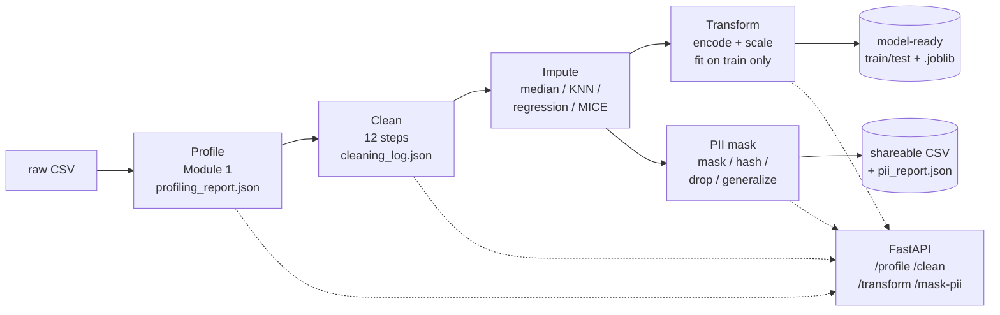
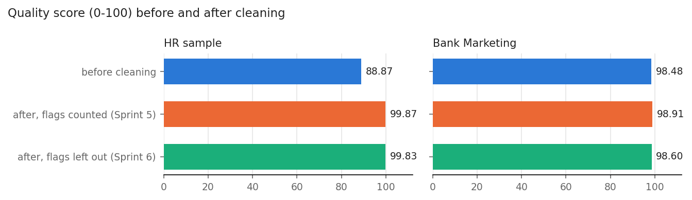
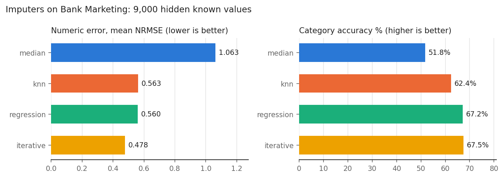
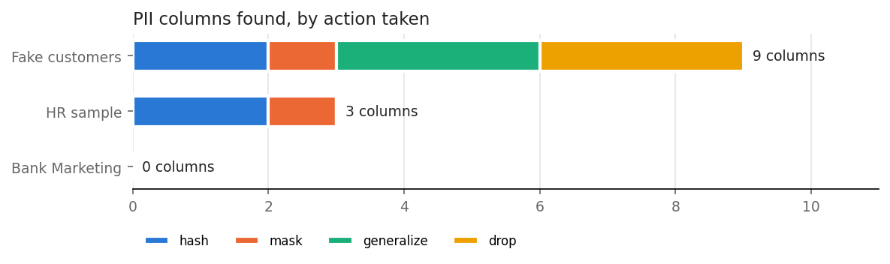

# Module 2 Summary — Cleaning & Transformation (Sprints 4–6)

Presentation material for Module 2. Details: [`module2_cleaning.md`](module2_cleaning.md),
sprint notes [`sprint4_summary.md`](sprint4_summary.md), [`sprint5_summary.md`](sprint5_summary.md),
[`sprint6_summary.md`](sprint6_summary.md).

## The problem
Real data arrives broken in ways a model cannot see:

- **Hidden gaps:** `unknown`, or `pdays = 999` meaning "never contacted".
- **Inconsistent values:** typos and mixed formats (`ENGINEERING `, `15/03/2020`, `"five"`).
- **Impossible values and outliers:** age 230, a salary of 9,999,999.
- **Duplicates:** exact copies, and the same person typed twice.
- **Personal data:** columns that should never reach a model or a log.

A model also needs numbers on similar scales, not text. Module 2 takes the raw CSV plus Module 1's
report and gives back data that is **clean, ML-ready and safe to share**. It explains every change it makes.

## The pipeline

| Step | Code | CLI | API |
|---|---|---|---|
| Profile | `src/profiling/` | `run_profiling.py` | `POST /profile` |
| Clean + impute | `src/cleaning/` | `run_cleaning.py` | `POST /clean` |
| Transform | `src/transform/` | `run_transform.py` | `POST /transform` |
| PII mask | `src/privacy/` | `run_masking.py` | `POST /mask-pii` |

## Key numbers

**Quality score (0–100) before → after cleaning.** The Sprint 6 version leaves cleaning's flag columns out:

| | Bank Marketing (41,188 × 21) | HR messy sample (523 × 10) |
|---|---|---|
| Sprint 4 (median imputation) | 98.48 → 98.90 | 88.86 → 99.83 (515 rows) |
| Sprint 5 (ML imputation, flags counted) | 98.48 → 98.91 | 88.87 → 99.87 |
| **Sprint 6 (flags left out, honest)** | **98.48 → 98.60** | **88.87 → 99.83** |

**Imputer comparison, Bank Marketing.** 10% of known values were hidden (9,000 cells), then each
method filled them in and was scored against the truth:

| | median / mode | knn | regression | **iterative (MICE, default)** |
|---|---|---|---|---|
| numeric error, mean NRMSE ↓ (1.0 = no better than the average) | 1.063 | 0.563 | 0.561 | **0.478** |
| category accuracy ↑ | 51.8% | 62.4% | 67.2% | **67.5%** |

**Transformation (Sprint 6).** Fitted on 80% train rows only:

| | Bank Marketing | HR sample |
|---|---|---|
| Train / test rows | 32,940 / 8,236 (stratified on `y`) | 406 / 102 |
| Feature columns in → model columns out | 26 → 63 (incl. age groups) | 9 → 16 |
| Dropped, with a reason | `pdays` (96% empty), target `y` | ID, name, email, phone, `hire_date` |
| Skew fixed (Yeo-Johnson) | duration 3.19 → 0.17, campaign 4.89 → 0.37, nr.employed −1.04 → −0.34 | salary 8.87 → 1.16 |
| Time | 1.1 s | 0.1 s |

**PII (Sprint 6).**

| Dataset | Findings | Actions taken |
|---|---|---|
| Fake customers file (300 rows) | 9 / 9 planted PII columns found, all with confidence 1.0 | name and email **hashed**, phone **masked**, SSN / card / street **dropped**, DOB / zip / IP **generalised** |
| HR sample | 3 PII columns | – |
| Bank Marketing | 0 PII columns (correct) | – |

A test checks that no original value survives in the output or the report.

**Tests:**

| Sprint | Tests | Lint |
|---|---|---|
| 2 | 44 | – |
| 3 | 70 | – |
| 4 | 110 | – |
| 5 | 167 | ruff clean |
| **6** | **219** | ruff clean, now checked in CI too |

## 3 bugs I found and how I fixed them
1. **MICE always predicted the same category** (Sprint 5).
   - *How I found it:* the imputer evaluation showed iterative imputation at 46% accuracy on categories, exactly the same as "always take the most common value".
   - *Cause:* with full one-hot encoding, the sibling columns (`job_admin`, `job_tech`, …) predicted each other in a circle.
   - *Fix:* drop-first encoding. Accuracy went from 46% to 100% on the test data.
   - **Lesson:** measure, don't assume.
2. **Outliers poisoned the imputers** (Sprint 5).
   - *How I found it:* on the real HR file, missing salaries were filled with ≈ 187,000.
   - *Cause:* the regression and MICE models learned from the five flagged salaries of 9,999,999. A flagged value stays in the output, but it must not teach the model.
   - *Fix:* hide flagged outliers while the imputers learn. Imputed salaries are now ≈ 81,000, and a test fails without the fix.
3. **The quality score rewarded adding columns** (Sprint 6).
   - *Cause:* cleaning adds 0/1 flag columns (`salary_outlier`, `is_anomaly`, `previously_contacted`, …) that are never empty, so "% of cells filled" went up without anything being fixed.
   - *Fix:* flag columns are left out of all four dimensions and scored apart.
   - *Effect:* Bank 98.91 → 98.60 and HR 99.87 → 99.83. The numbers went down because they are now honest.

Smaller bugs from this sprint:
- `log1p` made a left-skewed column worse. Fix: try log and Yeo-Johnson and keep the more symmetric one.
- Yeo-Johnson overflowed on values like 9,999,999. Fix: standardise first.
- The PII leak test raised a false alarm on a 5-digit zip that appeared inside a hex hash in another column. Fix: compare each cell with its own original.

## Design decisions worth defending
- **Fit on train only.** The scaler learns its mean and standard deviation from the training rows. The test rows are only transformed. A test checks that `scaler.n_samples_seen_ == len(train)`.
- **Every transform decision comes with a reason** in `transform_report.json`, for example *"skew 3.19 > 1 → Yeo-Johnson (tried log and yeo-johnson, kept the more symmetric); 0.0% outliers → standard scaler"*.
- **`unknown` stays a category:** `default_unknown` is its own one-hot column. Ordinal columns get an indicator for values outside the order.
- **The hash is salted, the salt is a secret.** HMAC-SHA256 with the salt from `GATEKEEPER_PII_SALT`:
  - The same email gives the same code, so tables can still be joined.
  - Without the salt, nobody can rebuild the codes by hashing a list of known emails.
  - With no salt set, hashing fails with a clear message *before* any data is changed.
- **No raw PII in reports, logs or errors.** The API logs only the error *type*, and returns a plain 500 with no stack trace.

## Limitations
- **Iterative imputation is slow:** ≈ 49 s on 41k rows, against ≈ 2 s for median.
- **Random hiding flatters the evaluation.** It hides values completely at random, so real-world accuracy may be lower.
- **The completeness score still has a gap.** It counts the kept `unknown` and the empty `pdays` cells as missing, which is why Bank stays below 99.
- **PII detection is rule-based:** regexes plus column names. A column of names with no hint in its header and many repeats is treated as a category and missed. You can name it yourself with `--action customer=hash`.
- **Masked data still needs a human check.** Generalised zip codes and age bands can still identify people in small groups (k-anonymity is not checked).
- **Dates are dropped by the transform.** It does not yet turn them into features such as year or month.
- **The API is synchronous:** a large `/clean` request with `iterative` blocks one worker for up to a minute.

## Next steps (Module 3 → 4)
- Module 3: validate new data against `schema.json`, rule-based checks, anomaly detection and drift.
- Make iterative imputation faster (fit on a sample of rows), and add an optional `--imputer auto`.
- Module 4: one pipeline command (`profile → clean → transform → mask → validate`), YAML config and Docker.
