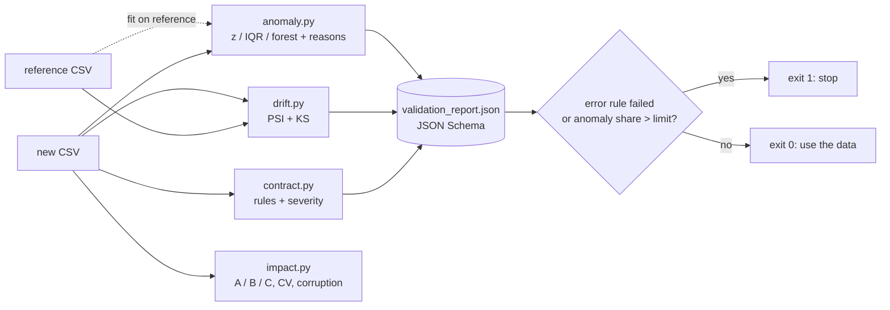

# Module 3 Presentation — Validation: contracts, drift, anomalies, impact

*Data Gatekeeper · CadetX AI Engineering & Data Science internship · Sprints 7–9*

---

## Slide 1 — The problem
- Modules 1–2 can describe and clean **one** file. Production data keeps **arriving**.
- A new file can be wrong in ways cleaning does not notice: a renamed unit, a changed mix of customers,
  an unknown code, a strange row.
- A model trained on last month's data scores this month's file **silently**. Nobody gets an error.
- **Goal of Module 3:** before a new file is used, give it a clear **pass / fail**, show **what moved**, list the
  **strange rows with reasons**, and measure whether all this **helps a model**.

---

## Slide 2 — What Module 3 does
| Question | Tool | Sprint |
|---|---|---|
| Does the file keep its promises (types, ranges, categories, missing, uniqueness)? | **data contract** (YAML) → pass / fail, exit code 0 / 1 / 2 | 7 |
| Did the data move compared with a good reference? | **drift**: PSI per column + KS, new categories | 7 |
| Which rows are unusual, and why? | **anomalies**: robust z, IQR, Isolation Forest + explanations | 9 |
| Does the gatekeeper actually help a model? Is it robust to dirty data? | **impact**: A raw / B gatekeeper / C, 5-fold CV, corruption test | 8 (+ fix in 9) |
| One answer per file | **`validation_report.json`** (+ JSON Schema), CLI, pipeline step, API | 9 |

---

## Slide 3 — Architecture

The same functions run behind 4 doors: the **CLI** (`gatekeeper validate | drift | anomalies | impact`), the
**pipeline** (`gatekeeper run --config pipeline.yaml`), the **API** (`POST /validate /drift /anomalies`) and
**Docker / CI**. PII values never leave a report (`src/privacy`).

---

## Slide 4 — How to run it
```bash
python gatekeeper.py contract init data/demo/bank_reference.csv --name bank_marketing
python gatekeeper.py validate new.csv --contract contracts/bank_marketing.yaml \
       --reference data/demo/bank_reference.csv --anomalies --exclude y
python gatekeeper.py impact data/raw/bank_marketing.csv --target y
python gatekeeper.py run --config pipeline.yaml          # profile -> ... -> anomalies -> drift -> impact
curl -F file=@new.csv -F contract=@contracts/bank_marketing.yaml http://127.0.0.1:8000/validate
pytest -q                                                 # 389 passed
```

---

## Slide 5 — Results: contracts and drift (Sprint 7)
Bank Marketing split 70 / 30 (seed 42). A "shifted" copy had three realistic changes: duration in minutes,
80% of telephone → cellular, 5% of ages emptied.

| | clean 30% | shifted |
|---|---|---|
| Contract (97 rules, drafted by `contract init`) | **PASS** 97 / 97 | **FAIL** 2 error rules (age 5% missing, duration not integer) |
| Drift | 21 / 21 columns stable | **major on exactly the 3 changed columns**: duration PSI 8.26, contact 0.58, age 0.31 |

**Lesson:** contracts and drift catch different things. Duration rounded to whole minutes **passed the contract**
(exit 0) but drift still gave PSI 8.26.

---

## Slide 6 — Results: does cleaning help a model? (Sprint 8)
Same rows, same 5 folds, everything fitted on the train folds only (a test spies on every `fit()`).

| | LogisticRegression | HistGradientBoosting |
|---|---|---|
| ROC-AUC, B − A (95% CI) | −0.0002 [−0.0020, +0.0016] | +0.0001 [−0.0004, +0.0006] |
| PR-AUC, B − A | **+0.0197 [+0.0108, +0.0285]** | +0.0018 [−0.0052, +0.0087] |

**Honest answer:** on this clean, curated file, cleaning does **not** raise ROC-AUC. It helps the linear model
rank positives (PR-AUC) and calibrate (Brier). The tree model needs nothing.

**Where it matters: dirty data.** With 20% missing cells, LogReg loses 0.0259 ROC-AUC with the gatekeeper and
0.1234 without it.

---

## Slide 7 — Results: a weakness found, fixed and re-measured (Sprints 8 → 9)
Sprint 8 found that with all corruption kinds together, the gatekeeper **made HGB worse** (0.6368 vs 0.6906 at
20%). The cause: unseen `999`s stayed numbers, and the imputer filled gaps from them (72–74% of fills hit the clip
edge).

| HGB, all kinds, ROC-AUC | 5% | 10% | 20% |
|---|---|---|---|
| A raw | 0.8862 | 0.8202 | 0.6906 |
| B, Sprint 8 | 0.8839 | 0.7974 | 0.6368 |
| **B, Sprint 9 (step 8b + fallback)** | **0.9069** | **0.8598** | **0.7508** |

Clip-edge fills dropped from 71.7–73.8% to 0.0–4.5%. **Not fully closed:** `duration` has two genuine 999s,
so "never seen in train" lets 999 through there. Next fix: judge sentinels by frequency.

---

## Slide 8 — Results: anomalies (Sprint 9)
412 planted rows (1%) of three kinds, settings committed before the first run
(rounded to 2 decimals here; exact values in `docs/sprint-09.md`):

| ROC-AUC / precision@k | extreme | combination | shift | all |
|---|---|---|---|---|
| Isolation Forest | 0.78 / 0.02 | **0.81** / 0.01 | **0.92** / 0.04 | **0.84** / 0.05 |
| robust z | 0.73 / **0.21** | 0.80 / 0.00 | 0.64 / 0.08 | 0.72 / 0.10 |
| IQR | **0.80** / 0.07 | 0.50 / 0.01 | 0.75 / 0.07 | 0.68 / **0.16** |

- The forest ranks best overall and on combinations and shifts. The simple z-score is the most precise on single
  extremes.
- Precision is low for every method. The real file already has hundreds of genuinely odd rows, and `euribor3m` is
  bimodal (13,369 normal rows have robust z > 20).
- Real top anomaly: row 40879, explained as `previous = 3`, `age = 75`, `nr.employed = 4963.6`. Unusual,
  not an error; a person decides.

---

## Slide 9 — What I learned
1. **A contract and a drift check are different questions.** "Is each value allowed?" vs "did the population move?"
   A unit change can pass the first and fail the second.
2. **Measure the claim, not the feature.** The impact study showed no ROC-AUC gain, and that is the result I report.
3. **Robustness tests find real bugs.** The 999 weakness was invisible on clean data. It came out only by
   corrupting the test set on purpose, and the same test proves the fix.
4. **Never tune on the labels.** The anomaly settings were committed before the first evaluation. When the
   result was weak, I explained it (bimodal column, natural outliers) instead of changing the setup.
5. **Explanations beat scores.** Leave-one-column-out showed that `previous` drives the top anomalies, which a
   z-score can't show because its MAD is 0.

---

## Slide 10 — Limitations
- One dataset (Bank Marketing), and a clean one. A messier dataset may show a bigger impact.
- Sentinels are judged by "seen in train", not by frequency.
- Anomalies use numeric columns only; robust z struggles with bimodal columns.
- Step 8b turns new but legitimate values (beyond the train range) into missing, unless a contract widens the range.
- Planted anomalies are my own design. Real anomalies may differ.

---

## Slide 11 — Next: Module 4 (Sprints 10–12)
The pipeline, Docker and CI were already pulled forward in Sprints 7–8, so Module 4 is about finishing touches:
- **Sprint 10:** the sentinel rule by frequency and a re-run of the robustness study; categories in the forest;
  the impact study on a second, messier dataset.
- **Sprint 11:** an HTML report from `validation_report.json` + `summary.json`; `POST /run` for the whole pipeline;
  logging to a file.
- **Sprint 12:** final end-to-end demo, architecture diagram, final presentation and recorded demo.
