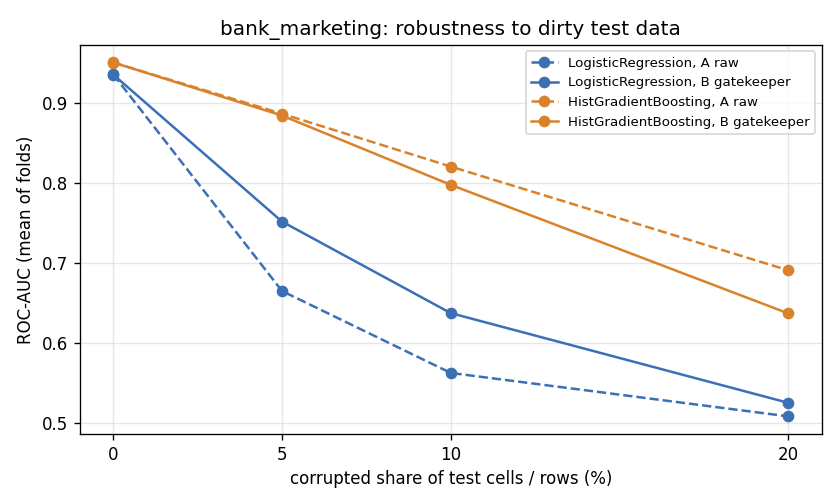

# Sprint 8 Summary — Module 3 part 2: downstream impact + one-command pipeline

**Goal:** measure honestly whether Data Gatekeeper's cleaning improves a downstream model, and run
the whole flow with one command.

## What I built
| Feature | Where |
|---|---|
| `FoldImputer`: the Sprint 5 imputers split into fit (train rows) / transform (new rows); same result as `impute_columns` on one table | `src/cleaning/imputers.py` |
| A / B / C comparison with 5-fold stratified CV, LogisticRegression + HistGradientBoosting, ROC-AUC, PR-AUC, F1, Brier, paired fold differences (95% t-interval + Wilcoxon) | `src/impact/impact.py` |
| Seeded corruption injectors: missing, sentinels (`999` / `?`), decimal-comma numbers, duplicate rows; each changes exactly its fraction | `src/impact/corruption.py` |
| Markdown tables + robustness line chart | `src/impact/report.py` |
| `gatekeeper impact` and `gatekeeper run --config` (profile → validate → clean → mask_pii → quality → drift → impact) with `summary.json` / `summary.md` | `gatekeeper.py`, `src/pipeline/run.py`, `pipeline.yaml` |
| Dockerfile runs `run`; CI runs the fixture pipeline (impact skipped) locally and in Docker, and checks the gate's exit 1 | `Dockerfile`, `.github/workflows/tests.yml` |
| Diagnosis script for the surprising robustness result | `scripts/diagnose_combined_corruption.py` |
| Tests **297 → 351**, all passing; ruff clean | `tests/test_impact.py`, `test_corruption.py`, `test_pipeline_run.py` |

## How the comparison stays honest
- **Same rows, same folds, same seed.** All three variants score the *same* test rows of each fold
  (B and C never drop test rows), so the five fold scores are paired.
- **Fit inside each fold only.** For B and C, the profile and schema (which values are missing codes,
  which categories exist), the train-only dedupe, the imputer, the encoders, the scalers and the model are
  all fitted on the train rows of the fold. `test_every_fitted_part_sees_only_train_rows` spies on every
  `fit()` and checks that the rows it receives are inside that fold's train rows and outside its test rows.
- **No overclaiming.** A difference is called "better" only when its 95% t-interval excludes 0. With 5
  folds the smallest possible two-sided Wilcoxon p is 0.0625, so Wilcoxon can never reach 0.05 here.

| variant | what it does |
|---|---|
| A raw | numbers read as numbers, gaps filled with median / most common value, one-hot, standard scaler. `unknown` stays a category, `pdays = 999` stays the number 999, duplicates stay |
| B gatekeeper | cleaning steps 1–8 (`pdays 999` → `previously_contacted`, disguised missing → NaN, `default` keeps `unknown`, …), exact duplicates removed from the train part, iterative (MICE) imputer, Sprint 6 transform (ordinal `education`, Yeo-Johnson / log, scalers, one-hot) |
| C | B with a median / mode imputer, so B − C is the imputer's own effect |

## Commands
```bash
python gatekeeper.py impact data/raw/bank_marketing.csv --target y      # writes reports/bank_marketing_impact.{json,md} + _robustness.png
python gatekeeper.py run --config pipeline.yaml                         # the whole flow, impact included
python gatekeeper.py run --config tests/fixtures/pipeline_ci.yaml --skip impact   # what CI runs
python scripts/diagnose_combined_corruption.py                          # the robustness diagnosis below
```

## Results: Bank Marketing (41,188 rows, 11.27% `yes`), 5-fold CV, seed 42
Run time 554.2 s (A ≈ 2 s per fold, B 44–143 s per fold, mostly the iterative imputer; C 8–14 s).
Duplicate rows removed from the train folds: 9, 7, 6, 9, 8.

**Cross-validated metrics (mean ± std over 5 folds)**

| model | variant | ROC-AUC | PR-AUC | F1 @0.5 | Brier ↓ |
|---|---|---|---|---|---|
| LogisticRegression | A raw | 0.9353 ± 0.0036 | 0.5995 ± 0.0244 | 0.5176 ± 0.0087 | 0.0629 ± 0.0016 |
| LogisticRegression | B gatekeeper | 0.9351 ± 0.0032 | 0.6192 ± 0.0198 | 0.5145 ± 0.0117 | 0.0616 ± 0.0014 |
| LogisticRegression | C median imputer | 0.9351 ± 0.0032 | 0.6194 ± 0.0197 | 0.5149 ± 0.0121 | 0.0615 ± 0.0015 |
| HistGradientBoosting | A raw | 0.9502 ± 0.0023 | 0.6679 ± 0.0225 | 0.6051 ± 0.0129 | 0.0553 ± 0.0013 |
| HistGradientBoosting | B gatekeeper | 0.9502 ± 0.0025 | 0.6697 ± 0.0247 | 0.6108 ± 0.0068 | 0.0551 ± 0.0014 |
| HistGradientBoosting | C median imputer | 0.9498 ± 0.0023 | 0.6693 ± 0.0220 | 0.6062 ± 0.0079 | 0.0553 ± 0.0012 |

**Paired difference B − A (per fold, then averaged)**

| model | metric | mean diff | 95% CI | Wilcoxon p | verdict |
|---|---|---|---|---|---|
| LogisticRegression | ROC-AUC | −0.0002 | [−0.0020, +0.0016] | 1.0000 | no clear difference |
| LogisticRegression | PR-AUC | +0.0197 | [+0.0108, +0.0285] | 0.0625 | better |
| LogisticRegression | F1 @0.5 | −0.0031 | [−0.0128, +0.0066] | 0.4375 | no clear difference |
| LogisticRegression | Brier ↓ | −0.0013 | [−0.0017, −0.0009] | 0.0625 | better |
| HistGradientBoosting | ROC-AUC | +0.0001 | [−0.0004, +0.0006] | 1.0000 | no clear difference |
| HistGradientBoosting | PR-AUC | +0.0018 | [−0.0052, +0.0087] | 0.8125 | no clear difference |
| HistGradientBoosting | F1 @0.5 | +0.0057 | [−0.0020, +0.0135] | 0.3125 | no clear difference |
| HistGradientBoosting | Brier ↓ | −0.0001 | [−0.0004, +0.0001] | 0.4375 | no clear difference |

The imputer on its own (B − C) makes no measurable difference on any metric: LogReg PR-AUC −0.0002
[−0.0009, +0.0005], HGB ROC-AUC +0.0004 [−0.0002, +0.0011]. C − A for LogReg PR-AUC is +0.0199
[+0.0110, +0.0288], the same gain as B − A. All 24 comparisons are in `reports/bank_marketing_impact.md`.

## Results: robustness to dirty test data
The models are trained on clean train folds; only the test folds are corrupted (seeded per fold and
level). "all" applies every kind at the given level; each kind is also measured alone.
ROC-AUC, mean of 5 folds:

| corruption | model | variant | 0% | 5% | 10% | 20% | change at 20% |
|---|---|---|---|---|---|---|---|
| all kinds | LogisticRegression | A | 0.9353 | 0.6647 | 0.5624 | 0.5081 | −0.4271 |
| all kinds | LogisticRegression | B | 0.9351 | 0.7515 | 0.6371 | 0.5251 | −0.4100 |
| all kinds | HistGradientBoosting | A | 0.9502 | 0.8862 | 0.8202 | 0.6906 | −0.2595 |
| all kinds | HistGradientBoosting | B | 0.9502 | 0.8839 | 0.7974 | 0.6368 | −0.3135 |
| missing | LogisticRegression | A | 0.9353 | 0.8984 | 0.8692 | 0.8118 | −0.1234 |
| missing | LogisticRegression | B | 0.9351 | 0.9282 | 0.9220 | 0.9091 | −0.0259 |
| missing | HistGradientBoosting | A | 0.9502 | 0.9346 | 0.9221 | 0.8955 | −0.0547 |
| missing | HistGradientBoosting | B | 0.9502 | 0.9407 | 0.9338 | 0.9182 | −0.0321 |
| sentinels | LogisticRegression | A | 0.9353 | 0.6897 | 0.5944 | 0.5181 | −0.4172 |
| sentinels | LogisticRegression | B | 0.9351 | 0.7718 | 0.6679 | 0.5563 | −0.3788 |
| sentinels | HistGradientBoosting | A | 0.9502 | 0.9185 | 0.8869 | 0.8257 | −0.1245 |
| sentinels | HistGradientBoosting | B | 0.9502 | 0.9190 | 0.8881 | 0.8264 | −0.1238 |
| numbers as text | LogisticRegression | A | 0.9353 | 0.8962 | 0.8667 | 0.8053 | −0.1300 |
| numbers as text | LogisticRegression | B | 0.9351 | 0.9292 | 0.9229 | 0.9118 | −0.0232 |
| numbers as text | HistGradientBoosting | A | 0.9502 | 0.9344 | 0.9194 | 0.8912 | −0.0590 |
| numbers as text | HistGradientBoosting | B | 0.9502 | 0.9423 | 0.9330 | 0.9175 | −0.0328 |
| duplicates | LogisticRegression | A | 0.9353 | 0.9350 | 0.9347 | 0.9356 | +0.0004 |
| duplicates | LogisticRegression | B | 0.9351 | 0.9347 | 0.9345 | 0.9355 | +0.0004 |
| duplicates | HistGradientBoosting | A | 0.9502 | 0.9501 | 0.9499 | 0.9503 | +0.0001 |
| duplicates | HistGradientBoosting | B | 0.9502 | 0.9502 | 0.9500 | 0.9503 | +0.0001 |



**Surprise: with all kinds combined, HistGradientBoosting degrades faster with the gatekeeper
(0.6368 vs 0.6906 at 20%), although B is as good or better on every kind alone.** I checked this
instead of explaining it away (`scripts/diagnose_combined_corruption.py`, fold 0, 20%, HGB):

| corruption at 20% | A raw | B iterative | C median |
|---|---|---|---|
| all kinds | 0.6901 | 0.6434 | 0.7017 |
| missing + numbers as text + duplicates | 0.8296 | 0.8772 | 0.8248 |
| missing + sentinels | 0.7562 | 0.7296 | 0.7680 |

Cause: the gatekeeper is fitted on clean train rows, where `999` never appears in e.g. `euribor3m`, so the
`999`s injected into the test rows are not recognised as missing codes. Only `age` is protected, by its
0–120 business rule. About 2,000 `999`s stay in each economic column (euribor3m 2,050, nr.employed 2,078,
emp.var.rate 2,089). The iterative imputer then predicts the *missing* cells from those absurd values, and
71.7–73.8% of its fills land on the clip edge (the train minimum or maximum). A median fill does not look
at other columns, so C (and A) are not dragged along. Without sentinels, B is clearly the best of the three.

## Honest conclusion
- **On this clean, well-curated dataset, gatekeeper cleaning does not improve ROC-AUC** for either model.
  HistGradientBoosting gains nothing on any metric. That is expected: trees split on `pdays = 999` directly
  and do not care about scaling or skew.
- **LogisticRegression gets better-ranked positives and better calibration**: PR-AUC +0.0197 and Brier
  −0.0013, both with CIs excluding 0. C gets the same gain, so it comes from the cleaning and transform steps,
  not the imputer. The likely source is turning `pdays = 999` into a 0/1 flag and power-transforming the skewed
  `duration` / `campaign`, which a linear model cannot do itself. I did not run an ablation per step to prove
  this.
- **The iterative imputer (the Sprint 5 default) brings no measurable gain here** (B − C ≈ 0). It is 5–10× slower.
  Only about 0.5% of the cells are imputed, almost all in categorical columns.
- **The gatekeeper's real value shows on dirty data**. With 20% missing cells, LogReg loses 0.0259 ROC-AUC with it
  and 0.1234 without it. Decimal-comma numbers cost 0.0232 vs 0.1300. Duplicated test rows change nothing.
- **It has a weakness**: in prediction mode it does not recognise sentinels it never saw in training, and
  the iterative imputer amplifies them.

## Pipeline run on Bank Marketing
`python gatekeeper.py run --config pipeline.yaml`: **passed, exit 0, 496.8 s**
(`reports/run_20261125-182141/`). The impact numbers in this run are **bit-identical** to the standalone
`gatekeeper impact` run above (results, all 24 comparisons, every robustness row), so the study is
reproducible with seed 42.

| # | step | status | seconds | result |
|---|---|---|---|---|
| 1 | profile | passed | 5.01 | 41,188 rows, 21 columns, 12 duplicate rows, 13 issues, quality 98.48 |
| 2 | validate | passed | 0.95 | `contracts/bank_marketing.yaml`: 97 / 97 rules passed |
| 3 | clean | passed | 75.37 | 41,188 → 41,176 rows, 4,121 disguised missing → NaN, 4,120 values imputed |
| 4 | mask_pii | passed | 0.41 | 0 PII columns |
| 5 | quality | passed | 0.00 | 98.48 → 98.60 (+0.12) |
| 6 | drift | passed | 1.02 | vs `bank_reference.csv`: 21 stable, 0 major (the reference is 70% of this file) |
| 7 | impact | passed | 413.94 | ROC-AUC B − A: LogReg −0.0002 [−0.0020, +0.0016], HGB +0.0001 [−0.0004, +0.0006] |

The contract gate was checked on the fixture: `orders_bad.csv` stops the run at `validate`
with exit 1, and the five later steps show `not_run` (test and CI step).
(This run's `summary.md` left the impact cell empty; that display bug is fixed and the numbers above come
from its `summary.json`.)

## Limitations
- One dataset, and a clean one: only 12 duplicate rows and about 4,100 imputed cells. A messier dataset may show a
  different picture.
- 5 folds give 5 paired values. The t-interval assumes roughly normal fold differences, and Wilcoxon cannot
  go below p = 0.0625.
- B does not include the outlier step (Isolation Forest flags) or fuzzy duplicates; their per-fold versions
  are not built yet.
- F1 is measured at a fixed 0.5 threshold. With 11% positives a tuned threshold would give a higher F1 for
  every variant.
- Robustness corrupts all feature columns, not the label. The duplicate injector reweights test rows but cannot
  change any prediction, so a flat line is the expected result.
- The impact step takes about 9 minutes on 41k rows (the iterative imputer). CI therefore skips it with
  `--skip impact`, and the tests use small samples.

## Next steps (Sprint 9)
- **Fix the sentinel weakness**: before imputing new data, values outside the train / contract range should
  become missing (or be flagged), and the imputer should fall back to the median when its inputs are out of range.
  Then re-run the robustness test.
- Per-step ablation (special codes, transform, imputer) to show which step causes the LogReg PR-AUC gain.
- A per-fold outlier step; a messier second dataset for the impact study; threshold tuning for F1.
- Module 3 wrap-up: anomaly detection section and the Module 3 presentation.
