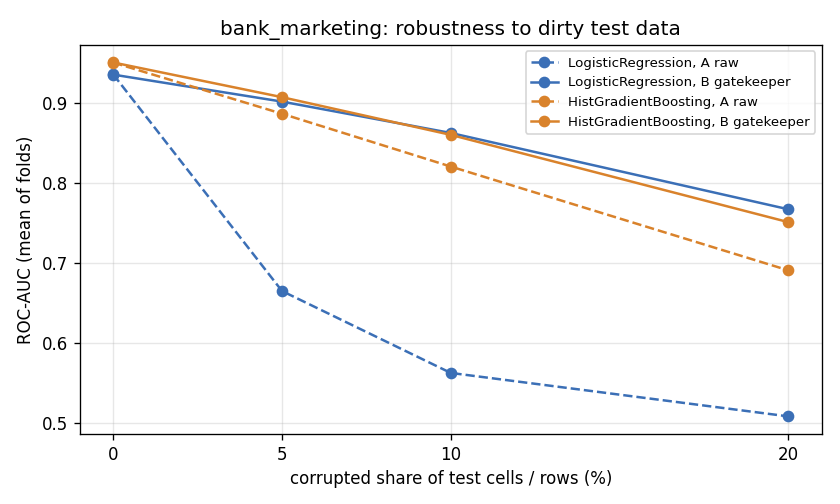

# Sprint 9 Summary — Module 3 part 3: sentinel fix, anomalies, one validation report

**Goal:** finish Module 3 (Validate).
- Fix the sentinel weakness found by the Sprint 8 robustness test.
- Add anomaly detection that explains itself, and measure it honestly.
- Put contract, drift and anomalies into one report, reachable from the CLI, the pipeline and the API.

## What I built
| Feature | Where |
|---|---|
| Step 8b `out_of_range_to_missing` (new rows only): numbers outside the train / contract range and common sentinels (999, 9999, −1, −999) that the train column never had become NaN before imputing, counted per column | `src/cleaning/cleaner.py`, `learn_from_train`, `contract_ranges` |
| `FoldImputer` falls back to median / mode for rows whose inputs are out of the train range (`fallbacks_` counts it) | `src/cleaning/imputers.py` |
| Anomaly scores: robust z (1.4826 × MAD), IQR distance, Isolation Forest `score_samples`; top-k explanations, with leave-one-column-out for the forest | `src/validation/anomaly.py` (shared maths in `src/cleaning/outliers.py`) |
| Planted anomalies (1%, 3 kinds, seed 42) + evaluation, settings committed before the first run | `src/validation/anomaly_inject.py`, `scripts/make_anomaly_demo.py`, `scripts/evaluate_anomalies.py` |
| One `validation_report.json` (contract + drift + anomalies) + JSON Schema | `src/validation/report.py`, `docs/validation_report.schema.json` |
| `gatekeeper anomalies`, `validate --reference --anomalies --fail-on-anomaly-share`, `impact --variants` | `gatekeeper.py` |
| Pipeline step `anomalies` (after quality, before drift) | `src/pipeline/run.py`, `pipeline.yaml` |
| API `POST /validate`, `/drift`, `/anomalies` with the Sprint 6 upload limits | `src/api/app.py` |
| Tests **351 → 389**, all passing; ruff clean | `test_sentinel_fix.py`, `test_anomaly.py`, `test_validation_report.py`, `test_api_sprint9.py`, `test_pipeline_run.py` |

## Commands
```bash
python gatekeeper.py validate new.csv --contract contracts/bank_marketing.yaml \
       --reference data/demo/bank_reference.csv --anomalies --exclude y   # one validation report
python gatekeeper.py anomalies data/raw/bank_marketing.csv --method iforest --top 5 --exclude y
python gatekeeper.py impact data/raw/bank_marketing.csv --target y --variants A,B   # robustness re-run
python scripts/diagnose_combined_corruption.py                            # clip-edge check
python scripts/make_anomaly_demo.py && python scripts/evaluate_anomalies.py
python gatekeeper.py run --config pipeline.yaml
```

## Part 1: the sentinel fix, BEFORE (Sprint 8) vs AFTER
The study was re-run with the same seed (42), folds (5) and levels, and with the same corruption code and
evaluation, for A and B only, because robustness uses only those two. Run time: 198.9 s.
**A's numbers are identical before and after (clean CV and every robustness row), so the measurement did not move.** The clean
CV scores of B barely changed (HGB ROC-AUC 0.9502 → 0.9503, LogReg 0.9351 → 0.9351, PR-AUC 0.6192 → 0.6193).

ROC-AUC on corrupted test folds, mean of 5 folds:

| corruption | model | variant | 5% | 10% | 20% |
|---|---|---|---|---|---|
| all kinds | HistGradientBoosting | A raw | 0.8862 | 0.8202 | 0.6906 |
| all kinds | HistGradientBoosting | B before | 0.8839 | 0.7974 | 0.6368 |
| all kinds | HistGradientBoosting | **B after** | **0.9069** | **0.8598** | **0.7508** |
| sentinels | HistGradientBoosting | A raw | 0.9185 | 0.8869 | 0.8257 |
| sentinels | HistGradientBoosting | B before | 0.9190 | 0.8881 | 0.8264 |
| sentinels | HistGradientBoosting | **B after** | **0.9249** | **0.8995** | **0.8498** |
| all kinds | LogisticRegression | A raw | 0.6647 | 0.5624 | 0.5081 |
| all kinds | LogisticRegression | B before | 0.7515 | 0.6371 | 0.5251 |
| all kinds | LogisticRegression | **B after** | **0.9014** | **0.8622** | **0.7669** |
| sentinels | LogisticRegression | A raw | 0.6897 | 0.5944 | 0.5181 |
| sentinels | LogisticRegression | B before | 0.7718 | 0.6679 | 0.5563 |
| sentinels | LogisticRegression | **B after** | **0.9153** | **0.8964** | **0.8576** |

The missing, decimal-comma and duplicate kinds are unchanged (each within 0.0001).
For HistGradientBoosting, B was worse than A at 10% and 20% with all kinds; now it is better at every level.



**Diagnosis script, fold 0, 20%, all kinds, HGB** (`scripts/diagnose_combined_corruption.py`):

| | before (Sprint 8) | after |
|---|---|---|
| ROC-AUC A / B / C | 0.6901 / 0.6434 / 0.7017 | 0.6901 / **0.7524** / 0.7123 |
| imputed values on the clip edge (train min / max): age, euribor3m, nr.employed, emp.var.rate | 71.7%, 73.0%, 73.8%, 73.8% | **0.0%, 2.0%, 2.3%, 4.5%** |
| `999` left as a number in euribor3m / nr.employed / emp.var.rate | 2,050 / 2,078 / 2,089 | 0 / 0 / 0 |
| cells set to missing by step 8b | – | 14,453 |
| imputer fallbacks to median / mode | – | 0 (step 8b already removed every out-of-range input) |

**The gap is not fully closed.** With sentinels alone at 20%, HGB B (0.8498) is still below its result with plain
missing cells (0.9182). I checked why:
- `duration` has two genuine 999s in the data, so the rule "a sentinel the train column never had"
  lets 999 through for `duration`.
- On fold 0, 1,744 of 8,238 test rows kept a fake `duration = 999` as a real number. `duration` is the
  strongest predictor.
- Treating those as missing raised fold 0 from 0.8529 to 0.9166 (sentinels only, 20%).

I did not change the rule after seeing this, because that would be tuning on the evaluation. The fix belongs
in the next sprint: compare how often a sentinel value appears against its train share, not just whether it
ever appeared. A smaller part comes from `pdays`: 43 real contact days turned into `999` read as "never
contacted", which is a legal code there. Undoing those changed fold 0 by only 0.0021.

## Part 2: anomaly detection, honest evaluation
**Setup (fixed and committed before the first run, never tuned).** `scripts/make_anomaly_demo.py` changed
412 of 41,188 rows (1.00%, seed 42): 137 *extreme* (one column set to max + 0.5 × range), 137 *combination*
(`euribor3m` moved to the 5th / 95th percentile against `emp.var.rate`, r = 0.97, so each value is normal alone)
and 138 *shift* (all 8 usable columns moved 1.5 robust SDs). The methods ran with their defaults: forest with
100 trees, seed 42, contamination 0.01; robust z flags at > 3.5; IQR flags at one column outside the fences.
For each kind, the evaluation uses the normal rows plus that kind's rows, with k = that kind's count.
Shared preparation took 4.05 s.

| method | kind | k | precision@k | recall@k | ROC-AUC | PR-AUC | seconds |
|---|---|---|---|---|---|---|---|
| iforest | all | 412 | 0.0510 | 0.0510 | **0.8374** | 0.0394 | 0.065 |
| iforest | extreme | 137 | 0.0219 | 0.0219 | 0.7776 | 0.0119 | 0.065 |
| iforest | combination | 137 | 0.0073 | 0.0073 | **0.8145** | 0.0084 | 0.065 |
| iforest | shift | 138 | 0.0435 | 0.0435 | **0.9195** | 0.0337 | 0.065 |
| zscore | all | 412 | 0.1019 | 0.1019 | 0.7241 | **0.1173** | 0.003 |
| zscore | extreme | 137 | **0.2117** | **0.2117** | 0.7315 | **0.2181** | 0.003 |
| zscore | combination | 137 | 0.0000 | 0.0000 | 0.8039 | 0.0236 | 0.003 |
| zscore | shift | 138 | **0.0797** | **0.0797** | 0.6375 | **0.0421** | 0.003 |
| iqr | all | 412 | **0.1578** | **0.1578** | 0.6845 | 0.0582 | 0.005 |
| iqr | extreme | 137 | 0.0657 | 0.0657 | **0.7979** | 0.0540 | 0.005 |
| iqr | combination | 137 | 0.0073 | 0.0073 | 0.5029 | 0.0073 | 0.005 |
| iqr | shift | 138 | 0.0652 | 0.0652 | 0.7522 | 0.0376 | 0.005 |

Flagged rows: iforest 412 (1.00%, by design), robust z 20,261 (49%), IQR 6,124 (15%).

**What the table says, and why:**
- **No method finds the planted rows reliably.** The best precision@k is 0.21 (robust z on extremes), so most of the
  top-ranked rows are real rows, not planted ones. This dataset already contains many genuinely unusual rows.
- **The baselines win on precision for single extremes, and I checked why it is still low.** Planted extremes in
  `campaign` / `duration` rank near the top for robust z (median rank 5 and 19.5). Those in the economic columns
  rank around 14,000–21,000, because `euribor3m` is **bimodal**: 32.8% of rows sit below 3 while the median
  is 4.857 and the robust SD is only 0.16. So 13,369 normal rows get robust z > 20 in that one column and bury
  everything else. Robust z assumes one bump in the middle; this column has two.
- **The forest ranks best overall (ROC-AUC 0.84) and on the two kinds it was chosen for**, combinations (0.81)
  and shifts (0.92). Its precision@k is still low: of the 412 rows it flags, only 21 are planted
  (0.0510 × 412); the other 391 are real rows that isolate faster (see the top 5 below).
- **IQR cannot see combinations** (ROC-AUC 0.50, chance level), as expected for a one-column method.
- **Runtime is not a concern**: 3–65 ms to score 41k rows, plus 4 s of shared preparation.

**Top 5 explained anomalies, real Bank file, no planted rows** (`gatekeeper anomalies data/raw/bank_marketing.csv
--method iforest --top 5 --exclude y`; contribution = how much the score drops when that one column is set to its
median; robust z "–" means the column has MAD = 0):

| rank | row | score | 1st reason | 2nd reason | 3rd reason |
|---|---|---|---|---|---|
| 1 | 40879 | 0.7184 | previous = 3 (median 0, z –, +0.0348) | age = 75 (median 38, z 3.57, +0.0309) | nr.employed = 4963.6 (median 5191, z 4.13, +0.0247) |
| 2 | 41153 | 0.7038 | previous = 5 (median 0, z –, +0.0520) | nr.employed = 4963.6 (z 4.13, +0.0297) | age = 67 (z 2.79, +0.0280) |
| 3 | 40951 | 0.6953 | previous = 3 (z –, +0.0377) | age = 70 (z 3.08, +0.0334) | nr.employed = 4963.6 (z 4.13, +0.0278) |
| 4 | 41126 | 0.6948 | previous = 5 (z –, +0.0609) | nr.employed = 4963.6 (z 4.13, +0.0403) | age = 61 (z 2.22, +0.0244) |
| 5 | 38580 | 0.6946 | age = 78 (z 3.85, +0.0271) | previous = 2 (z –, +0.0252) | cons.conf.idx = −26.9 (median −41.8, z 2.28, +0.0206) |

They are all the same real pattern: older clients contacted several times before, in the last campaign period
(nr.employed 4963.6). They are unusual, not errors, which is exactly what an anomaly list should leave a person to
judge. The leave-one-column-out explanation names `previous` first even though its robust z cannot be computed;
a z-score explanation could never show that.

## Part 3: the pipeline run on Bank Marketing
`python gatekeeper.py run --config pipeline.yaml`: **passed, exit 0, 239.27 s** (`reports/run_20261125-214316/`).

| # | step | status | seconds | result |
|---|---|---|---|---|
| 1 | profile | passed | 2.62 | 41,188 rows, 21 columns, 12 duplicate rows, 13 issues, quality 98.48 |
| 2 | validate | passed | 0.48 | `contracts/bank_marketing.yaml`: 97 / 97 rules passed |
| 3 | clean | passed | 33.34 | 41,188 → 41,176 rows, 4,121 disguised missing → NaN, 4,120 values imputed |
| 4 | mask_pii | passed | 0.21 | 0 PII columns |
| 5 | quality | passed | 0.00 | 98.48 → 98.60 (+0.12) |
| 6 | **anomalies** (new) | passed | 4.65 | iforest: 412 flagged (1.00%); top rows 40879, 41153, 40951 explained by previous, age, nr.employed |
| 7 | drift | passed | 0.51 | vs `bank_reference.csv`: no major column |
| 8 | impact | passed | 197.41 | ROC-AUC B − A: LogReg −0.0002 [−0.0019, +0.0016], HGB +0.0001 [−0.0004, +0.0006], no clear difference |

The impact step is the first full A / B / C study with the sentinel fix inside B. Its conclusions are the
same as in Sprint 8, and the numbers moved only in the last digit: LogReg PR-AUC B − A +0.0198 [+0.0107, +0.0289]
(Sprint 8: +0.0197), Brier −0.0013 [−0.0017, −0.0009]; HGB PR-AUC +0.0020 [−0.0041, +0.0081]; the imputer alone
(B − C) still makes no measurable difference. Timings differ from Sprint 8 because the machine had a different load.

## Honest conclusion
- **The sentinel fix works and is measured.** It brings HGB with all kinds at 20% from 0.6368 to 0.7508 (A: 0.6906)
  and LogReg from 0.5251 to 0.7669, with no cost on clean data. It does not close the sentinel gap completely,
  because the "seen in train" rule lets a code through when the train rows happen to contain it.
- **Anomaly detection is useful as an explained list, not as a detector you can trust blindly here.** On real data
  with natural outliers and a bimodal column, no method separates planted from natural anomalies well. The forest
  ranks best overall, the simple z-score is the most precise on single extremes, and the explanations make the
  difference visible.
- **Module 3 now gives one answer per file**: contract pass/fail, drift per column and an explained anomaly list,
  in one JSON with a schema, from the CLI, the pipeline or the API.

## Limitations
- Step 8b treats anything outside the train range as missing, so a real new record (age 99 when train stopped at 98)
  is imputed. A contract min / max can widen the range.
- Sentinels are judged by "ever seen in train", not by frequency (see Part 1).
- Anomalies use numeric columns only; categories (job, month) are not part of the forest yet.
- Robust z assumes one central bump; bimodal columns (euribor3m) flood its ranking.
- The anomaly evaluation uses one dataset and planted anomalies of three kinds I designed myself. Real anomalies
  may look different.

## Next steps (Module 4, Sprints 10–12)
- Sentinel rule by frequency (train share vs new share), then re-run the robustness study.
- Categories in the forest (one-hot or frequency encoding); a mixture-aware z for bimodal columns.
- Module 4: an HTML report from `validation_report.json` + `summary.json`, the impact study on a second, messier
  dataset, API endpoint for the whole pipeline, final demo and presentation.
