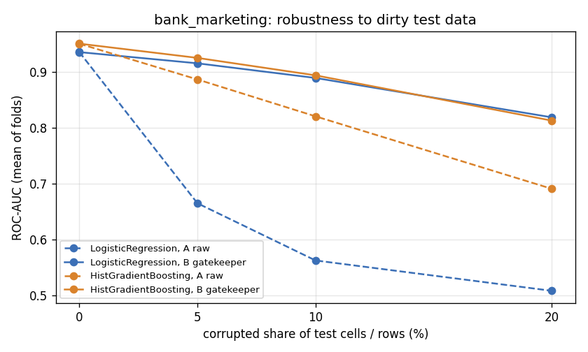
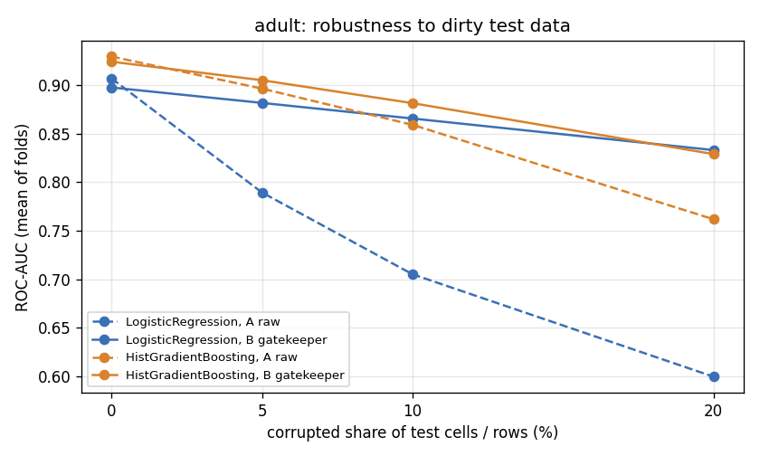

# Sprint 10 Summary — Module 4 part 1: close the known gaps

**Goal:** fix or measure the three gaps left by Sprint 9.
- Judge sentinels by how often they appear, not by "seen once in train".
- Let anomaly detection handle categories and bimodal columns.
- Run the impact study on a second, messier, real dataset.

## What I built
| Feature | Where |
|---|---|
| Step 8b judges every candidate code (999, 9999, −1, −999 + the profiler's numeric sentinels of that column) by **share**: missing when `new_share > max(5 × train_share, train_share + 0.005)`; every code's train share, new share and decision is logged | `src/cleaning/cleaner.py` (`sentinel_rule`, `sentinel_jumped`, `learn_from_train`), `RowCleaner.sentinel_log_` |
| `zscore_mixture`: 1–3 Gaussian bumps per numeric column (BIC, seed 42), distance to the nearest bump in its own SDs; plain robust z when one bump wins | `src/validation/anomaly.py` (`fit_mixture`) |
| `iforest_with_categories`: the forest also sees categorical columns (frequency encoding; `--encoding onehot`); leave-one-column-out repairs a category to its most common value | `src/validation/anomaly.py`, `gatekeeper.py` |
| UCI Adult downloader: official zip, pinned SHA-256, train + test joined, only format artefacts removed; `--split` for the two official parts | `scripts/download_adult.py`, `docs/dataset.md` |
| Adult contract + pipeline config | `contracts/adult.yaml`, `pipeline_adult.yaml` |
| Tests **389 → 407**, all passing; ruff clean | `test_sentinel_fix.py`, `test_anomaly.py`, `test_download_adult.py`, `test_validation_report.py` |

## Commands
```bash
python gatekeeper.py impact data/raw/bank_marketing.csv --target y --variants A,B   # robustness re-run
python scripts/diagnose_combined_corruption.py
python scripts/evaluate_anomalies.py                     # Sprint 9 planted data, all 5 methods
python gatekeeper.py anomalies data.csv --method zscore_mixture,iforest_with_categories --encoding onehot
python scripts/download_adult.py --split
python gatekeeper.py contract init data/demo/adult_train.csv --name adult
python gatekeeper.py validate data/demo/adult_test.csv --contract contracts/adult.yaml
python gatekeeper.py run --config pipeline_adult.yaml --skip impact
python gatekeeper.py impact data/raw/adult.csv --target income
```

## Part 1: sentinels by frequency (Bank Marketing)
`k = 5` and `min_abs = 0.005` were written into the config, with the reason, **before** any run and were never
changed. `k` alone would fire on chance for a rare code: `duration = 999` is 2 of 33k train rows, so 2–3 of 8k new
rows would already be "5×". The +0.5 percentage points (about 40 rows in an 8k batch) stops that. A very common code
(`pdays` 999, 96%) can never trigger, because 5 × 96% > 100%.

Robustness re-run with the same seed, folds and levels and the same corruption and evaluation, A and B only
(507.5 s). **A is identical to Sprints 8 and 9 in every row.** ROC-AUC, mean of 5 folds, B: Sprint 8 → 9 → 10:

| corruption | model | A raw (5 / 10 / 20%) | 5% | 10% | 20% |
|---|---|---|---|---|---|
| sentinels | HistGradientBoosting | 0.9185 / 0.8869 / 0.8257 | 0.9190 → 0.9249 → **0.9415** | 0.8881 → 0.8995 → **0.9333** | 0.8264 → 0.8498 → **0.9141** |
| sentinels | LogisticRegression | 0.6897 / 0.5944 / 0.5181 | 0.7718 → 0.9153 → **0.9287** | 0.6679 → 0.8964 → **0.9218** | 0.5563 → 0.8576 → **0.9065** |
| all kinds | HistGradientBoosting | 0.8862 / 0.8202 / 0.6906 | 0.8839 → 0.9069 → **0.9248** | 0.7974 → 0.8598 → **0.8936** | 0.6368 → 0.7508 → **0.8126** |
| all kinds | LogisticRegression | 0.6647 / 0.5624 / 0.5081 | 0.7515 → 0.9014 → **0.9151** | 0.6371 → 0.8622 → **0.8889** | 0.5251 → 0.7669 → **0.8184** |

The missing, decimal-comma and duplicate kinds are unchanged in Sprint 10 (identical to 4 decimals).
With sentinels at 20%, HGB B is now 0.9141, next to its result with plain missing cells (0.9182). The Sprint 9 gap is
closed.

**Clean data is not affected.** B's clean CV is identical to Sprint 9 to 4 decimals: LogReg ROC-AUC 0.9351 ± 0.0032,
PR-AUC 0.6193, F1 0.5146, Brier 0.0615; HGB ROC-AUC 0.9503 ± 0.0025, PR-AUC 0.6699, F1 0.6109, Brier 0.0551. The rule
never fires on clean test folds: in a clean fold a code's share is about its train share.



**Diagnosis, fold 0, 20%** (`scripts/diagnose_combined_corruption.py`):

| | Sprint 8 | Sprint 9 | Sprint 10 |
|---|---|---|---|
| HGB ROC-AUC, all kinds: A / B / C | 0.6901 / 0.6434 / 0.7017 | 0.6901 / 0.7524 / 0.7123 | 0.6901 / **0.8112** / 0.7634 |
| fake `duration = 999` still a number after cleaning (sentinels only) | – | 1,744 | **0** |
| step 8b cells set to missing (all kinds) | – | 14,453 | 16,521 |
| duration 999: train share → new share, decision | – | "seen in train" → kept | 0.0061% → 21.1702%, **missing: share jumped** |
| fills on the clip edge (age, euribor3m, nr.employed, emp.var.rate) | 71.7–73.8% | 0.0–4.5% | 0.0–4.5% |

## Part 2: better anomaly detection (Bank Marketing, the Sprint 9 planted data)
Same planted file (412 rows, seed 42, unchanged SHA-256 `07eae781…`), same features and settings. The two new methods
run **next to** the old ones, with their settings fixed in the code before their first run. **The 12 Sprint 9 rows
(3 methods × 4 kinds) are identical in Sprint 10**, so the comparison is fair.

| method | kind | precision@k | recall@k | ROC-AUC | PR-AUC |
|---|---|---|---|---|---|
| zscore (Sprint 9) | all | 0.1019 | 0.1019 | 0.7241 | 0.1173 |
| **zscore_mixture** | all | **0.5874** | **0.5874** | 0.8001 | **0.5568** |
| zscore (Sprint 9) | extreme | 0.2117 | 0.2117 | 0.7315 | 0.2181 |
| **zscore_mixture** | extreme | **0.9927** | **0.9927** | **1.0000** | **0.9965** |
| zscore (Sprint 9) | combination | 0.0000 | 0.0000 | 0.8039 | 0.0236 |
| **zscore_mixture** | combination | 0.0000 | 0.0000 | **0.4111** | 0.0026 |
| zscore (Sprint 9) | shift | 0.0797 | 0.0797 | 0.6375 | 0.0421 |
| **zscore_mixture** | shift | **0.4638** | **0.4638** | **0.9879** | **0.4646** |
| iforest (Sprint 9) | all | 0.0510 | 0.0510 | 0.8374 | 0.0394 |
| **iforest_with_categories** | all | 0.0121 | 0.0121 | 0.6800 | 0.0165 |
| iforest (Sprint 9) | extreme | 0.0219 | 0.0219 | 0.7776 | 0.0119 |
| **iforest_with_categories** | extreme | 0.0000 | 0.0000 | 0.6154 | 0.0044 |
| iforest (Sprint 9) | combination | 0.0073 | 0.0073 | 0.8145 | 0.0084 |
| **iforest_with_categories** | combination | 0.0000 | 0.0000 | 0.6534 | 0.0048 |
| iforest (Sprint 9) | shift | 0.0435 | 0.0435 | 0.9195 | 0.0337 |
| **iforest_with_categories** | shift | 0.0145 | 0.0145 | 0.7704 | 0.0087 |

IQR is unchanged (all: P@k 0.1578, ROC-AUC 0.6845). Flagged rows: zscore 20,261, zscore_mixture 451, iforest and
iforest_with_categories 412 each. Scoring time: 7 ms (zscore), 23 ms (mixture), 117 ms / 245 ms (forests), plus 9.47 s of
shared preparation (it now also fits the mixtures and the second forest).

**What helped, what did not, and why:**
- **The mixture z is the big win.** Precision@k on all kinds goes from 0.10 to 0.59. On single extremes it reaches 0.99
  (ROC-AUC 1.0000); on shifts it reaches 0.46 (ROC-AUC 0.9879). The bimodal `euribor3m` gets three bumps
  (≈ 0.81, 1.33, 4.82) and no longer calls a third of the rows extreme. Flags drop from 20,261 to 451.
- **It is worse than chance on combinations (ROC-AUC 0.4111), and that is honest.** The planted `euribor3m` values
  (0.797 and 4.966) sit in the *middle* of a real bump (median mixture z 0.1 vs 0.5 for all rows). A one-column method
  cannot see that the *pair* is wrong. It also shows that Sprint 9's robust z "found" combinations (0.8039) for the
  wrong reason: it gave the planted low values z ≈ 25 only because it calls the whole low bump extreme. Only the
  numeric forest sees broken pairs (0.8145).
- **BIC picked 3 bumps for every one of the 9 columns.** On 41k rows of discrete values, BIC rewards the extra bumps.
  The SD floor kept that from making normal values extreme, but "3 everywhere" means the method is closer to "density
  per column" than to "detect bimodality".
- **Categories made the forest worse** (ROC-AUC all kinds 0.8374 → 0.6800; its top 5 are all real rows). Every planted
  anomaly is numeric, so 12 extra categorical dimensions spend the forest's random splits on columns that do not help.
  The rows it ranks first are genuinely rare category patterns: `housing` and `loan` both `unknown` together with
  several earlier contacts (row 40941: previous = 3, loan and housing missing). These are real anomalies in the data,
  but not the planted ones. **Default stays `iforest` (numeric).**

## Part 3: UCI Adult (Census Income), a second, messier real dataset
48,842 rows (official train 32,561 + test 16,281), 15 columns, target `income` = `>50K` for 23.93%. Details, source,
license and checksum: `docs/dataset.md`. `sex`, `race` and `native-country` are sensitive; they were used like
every other column, with no fairness analysis (see Limitations).

**Profile → contract → validate → clean** (`gatekeeper run --config pipeline_adult.yaml --skip impact`, passed,
exit 0, 470.5 s; contract drafted on the train part, validated on the test part):

| step | result |
|---|---|
| profile | 48,842 rows, 0 empty cells, **6,709 disguised missing** (`?`: workclass 2,799, occupation 2,809, native-country 857; `capital-gain = 99999`: 244), true missing 0.92%, **52 duplicate rows**, 10 issues (1 high), no PII columns, quality **99.74** |
| contract | drafted from `adult_train.csv` (69 rules); `adult_test.csv` **passes 69 / 69**, and so does the full file. The draft lists `?` as an allowed value and sets the `capital-gain` maximum to 109,999 (99,999 + 10%): it describes the data, so a person has to edit it |
| clean | 48,842 → 48,790 rows (52 duplicates), 6,709 values → NaN, 6,700 imputed (iterative), 455.27 s (it encodes 97 columns), **quality 99.74 → 100.00 (+0.26)** |
| anomalies | iforest: 489 flagged (1%); top rows explained by large `capital-gain` (20,051 and 25,124 vs median 0), age 75–90, unusual hours |
| drift | full file vs the train part: 15 / 15 columns stable (it contains the train part) |

**Impact** (`gatekeeper impact data/raw/adult.csv --target income`, A / B / C, 5-fold CV, seed 42, both models,
robustness; run alone with `OPENBLAS_NUM_THREADS=1`, 2,050.5 s; B took 342–390 s per fold, almost all in the iterative
imputer; train duplicates removed per fold: 38, 36, 33, 33, 27):

| model | variant | ROC-AUC | PR-AUC | F1 @0.5 | Brier ↓ |
|---|---|---|---|---|---|
| LogisticRegression | A raw | **0.9067 ± 0.0048** | **0.7663 ± 0.0095** | **0.6606 ± 0.0117** | **0.1018 ± 0.0024** |
| LogisticRegression | B gatekeeper | 0.8974 ± 0.0052 | 0.7299 ± 0.0103 | 0.6433 ± 0.0141 | 0.1075 ± 0.0026 |
| LogisticRegression | C median imputer | 0.8958 ± 0.0052 | 0.7247 ± 0.0106 | 0.6391 ± 0.0144 | 0.1082 ± 0.0026 |
| HistGradientBoosting | A raw | **0.9292 ± 0.0030** | **0.8302 ± 0.0058** | **0.7119 ± 0.0058** | **0.0875 ± 0.0016** |
| HistGradientBoosting | B gatekeeper | 0.9239 ± 0.0027 | 0.8176 ± 0.0064 | 0.7016 ± 0.0086 | 0.0908 ± 0.0017 |
| HistGradientBoosting | C median imputer | 0.9270 ± 0.0024 | 0.8252 ± 0.0046 | 0.7107 ± 0.0060 | 0.0889 ± 0.0013 |

| B − A | ROC-AUC [95% CI] | PR-AUC [95% CI] | F1 | Brier ↓ |
|---|---|---|---|---|
| LogisticRegression | **−0.0093 [−0.0104, −0.0082]** | −0.0364 [−0.0386, −0.0342] | −0.0173 [−0.0206, −0.0141] | +0.0057 [+0.0050, +0.0063] |
| HistGradientBoosting | **−0.0053 [−0.0071, −0.0035]** | −0.0126 [−0.0191, −0.0062] | −0.0103 [−0.0153, −0.0054] | +0.0032 [+0.0018, +0.0047] |

**On Adult the gatekeeper makes both models worse on every metric, and every CI excludes 0.** C (median imputer) is
also worse than A, so the cause is the cleaning, not the imputer. The iterative imputer helps LogReg a little over the median
(B − C ROC-AUC +0.0016 [+0.0012, +0.0019]) and hurts HGB (−0.0031 [−0.0048, −0.0014]).

**Why: an ablation** (`scripts/diagnose_adult_impact.py`, same CV, C vs A, only the cleaning decisions changed):

| cleaning setting | LogReg ROC-AUC C − A | HGB ROC-AUC C − A | HGB PR-AUC C − A |
|---|---|---|---|
| as shipped | −0.0108 [−0.0120, −0.0097] | −0.0022 [−0.0030, −0.0014] | −0.0050 [−0.0068, −0.0033] |
| keep `?` as a category | −0.0094 [−0.0105, −0.0083] | −0.0018 [−0.0026, −0.0010] | −0.0042 [−0.0056, −0.0027] |
| keep `capital-gain = 99999` | −0.0094 [−0.0106, −0.0082] | −0.0008 [−0.0012, −0.0004] | −0.0014 [−0.0028, +0.0000] |
| keep both | −0.0079 [−0.0089, −0.0069] | **−0.0002 [−0.0007, +0.0003]** | −0.0005 [−0.0015, +0.0005] |

Two cleaning decisions that are right on Bank destroy real signal on Adult:
- **`capital-gain = 99999` is a top code, not "no value".** The profiler's sentinel rule (a 999-style number more than twice
  the next largest value) calls it missing. Yet **all 244 of those rows are `>50K`** (100%), so imputing it erases a perfect
  predictor.
- **`?` is informative.** Rows with `workclass = ?` are 9.47% `>50K`, against 24.81% otherwise (`occupation` 9.43%). Imputing a
  category hides that "unknown job" goes with low income. Bank's `default = unknown` was kept as a category for exactly this
  reason; Adult's `?` columns were not configured that way.

With both kept, the HGB gap is gone (CI includes 0). **LogReg still loses 0.0079 ROC-AUC with both fixes.** I did not find the
cause; the transform step (power transforms, rare countries grouped as "infrequent") is the next suspect and was not ablated.
I did **not** change the defaults after seeing this: they are reported, and the fix belongs to the configuration or Sprint 11.

**Robustness on Adult** (A and B trained on clean folds, corrupted test folds), ROC-AUC:

| corruption | model | A: 0 / 5 / 10 / 20% | B: 0 / 5 / 10 / 20% | drop at 20%: A vs B |
|---|---|---|---|---|
| all kinds | LogReg | 0.9067 / 0.7893 / 0.7051 / 0.5997 | 0.8974 / 0.8815 / 0.8654 / 0.8329 | −0.3070 vs **−0.0644** |
| all kinds | HGB | 0.9292 / 0.8962 / 0.8589 / 0.7617 | 0.9239 / 0.9049 / 0.8812 / 0.8288 | −0.1675 vs **−0.0951** |
| sentinels | LogReg | 0.9067 / 0.7966 / 0.7158 / 0.6182 | 0.8974 / 0.8911 / 0.8850 / 0.8739 | −0.2885 vs **−0.0235** |
| sentinels | HGB | 0.9292 / 0.9088 / 0.8898 / 0.8466 | 0.9239 / 0.9170 / 0.9096 / 0.8953 | −0.0826 vs **−0.0286** |
| missing | LogReg | 0.9067 / 0.8993 / 0.8916 / 0.8741 | 0.8974 / 0.8915 / 0.8857 / 0.8743 | −0.0326 vs −0.0230 |
| missing | HGB | 0.9292 / 0.9227 / 0.9165 / 0.9014 | 0.9239 / 0.9176 / 0.9098 / 0.8956 | −0.0279 vs −0.0283 |
| decimal comma | LogReg | 0.9067 / 0.9043 / 0.9019 / 0.8975 | 0.8974 / 0.8931 / 0.8880 / 0.8815 | −0.0092 vs **−0.0159** |
| decimal comma | HGB | 0.9292 / 0.9264 / 0.9232 / 0.9173 | 0.9239 / 0.9183 / 0.9123 / 0.9019 | −0.0120 vs **−0.0220** |
| duplicates | both | flat (+0.0008) | flat (+0.0007 / +0.0008) | – |



On dirty data the gatekeeper again holds up much better against sentinels and mixed corruption; from 5% of "all kinds"
on, B is above A for both models. Against decimal-comma numbers it degrades **faster** than raw. A likely reason (not
verified) is that A fills a broken `capital-gain` / `capital-loss` with the median (0, right for 92–95% of rows), while
the iterative imputer predicts a non-zero amount.

## Honest conclusion
- **The frequency rule closes the sentinel gap on Bank** (HGB, sentinels 20%: 0.8264 → 0.8498 → 0.9141) with no cost on clean
  data. The fake `duration = 999` went from 1,744 to 0.
- **The mixture z is the best anomaly method so far** for single extremes and shifts (precision@k 0.10 → 0.59 overall). It
  cannot see broken combinations, and categories made the forest worse. Both results are reported as measured.
- **The second dataset changed the story.** On clean, curated Bank data the gatekeeper was neutral-to-helpful. On Adult it
  **hurts every metric for both models**, because two of its default decisions (a top code read as a sentinel, an informative
  `?` imputed) remove real signal. The quality score went *up* (99.74 → 100.00) while the models got worse. A quality score
  measures what cleaning changes, not whether those changes are right for the task. The gatekeeper's clear value is
  robustness: on dirty incoming data it loses much less than raw data, on both datasets.
- **Running a second dataset found two real bugs** (the Bank `education` order wiping out Adult's `education`, now fixed) and
  showed that iterative imputation does not scale to many one-hot columns (6–7 minutes per fold).

## Limitations
- `k` and `min_abs` were chosen by reasoning, not measured on a second dataset. A tiny batch (e.g. 10 rows) with one
  999 counts as a 10% share and is treated as missing.
- `zscore_mixture` cannot see combinations, and BIC chose 3 bumps for every Bank column. The categorical forest does
  not help when anomalies are numeric.
- Adult has sensitive attributes (`sex`, `race`, `native-country`). They were used like any other column, including in
  `iforest_with_categories`; **no fairness analysis was done** (e.g. whether cleaning or imputation changes error rates per
  group).
- The Adult ablation uses C (median imputer) to be fast; B (iterative) was not ablated. The remaining LogReg gap is
  unexplained.
- The Adult impact run used `OPENBLAS_NUM_THREADS=1` (1.7× faster SVD); BLAS threading can change the last digits of
  floating-point sums, so a run with other settings may differ in the 4th decimal.
- The iterative (MICE) imputer is very slow on Adult: its 8 categorical columns encode to 97 columns
  (`native-country` alone has 41 values), see Part 3. This is the old "faster iterative imputation" item from Sprint 6.

## Next steps (Sprint 11)
- **Decisions that need a person, made visible**: report "sentinel candidates" that look like a top code (the value is the
  maximum and its rows have a very different label rate) and `?`-style codes whose rows behave differently, and let the
  contract / config say "keep as category" or "keep as value" (`keep_as_category` already exists).
- Ablate the transform step for LogReg on Adult (the remaining −0.0079).
- Faster iterative imputation (`skip_complete`, fewer rounds, or `n_nearest_features`) and a per-run timing budget.
- A first fairness check on Adult: error rates per `sex` / `race` group for A and B.
- The Sprint 11 plan: one-page HTML report from `validation_report.json` + `summary.json`, `POST /run`, logging.
