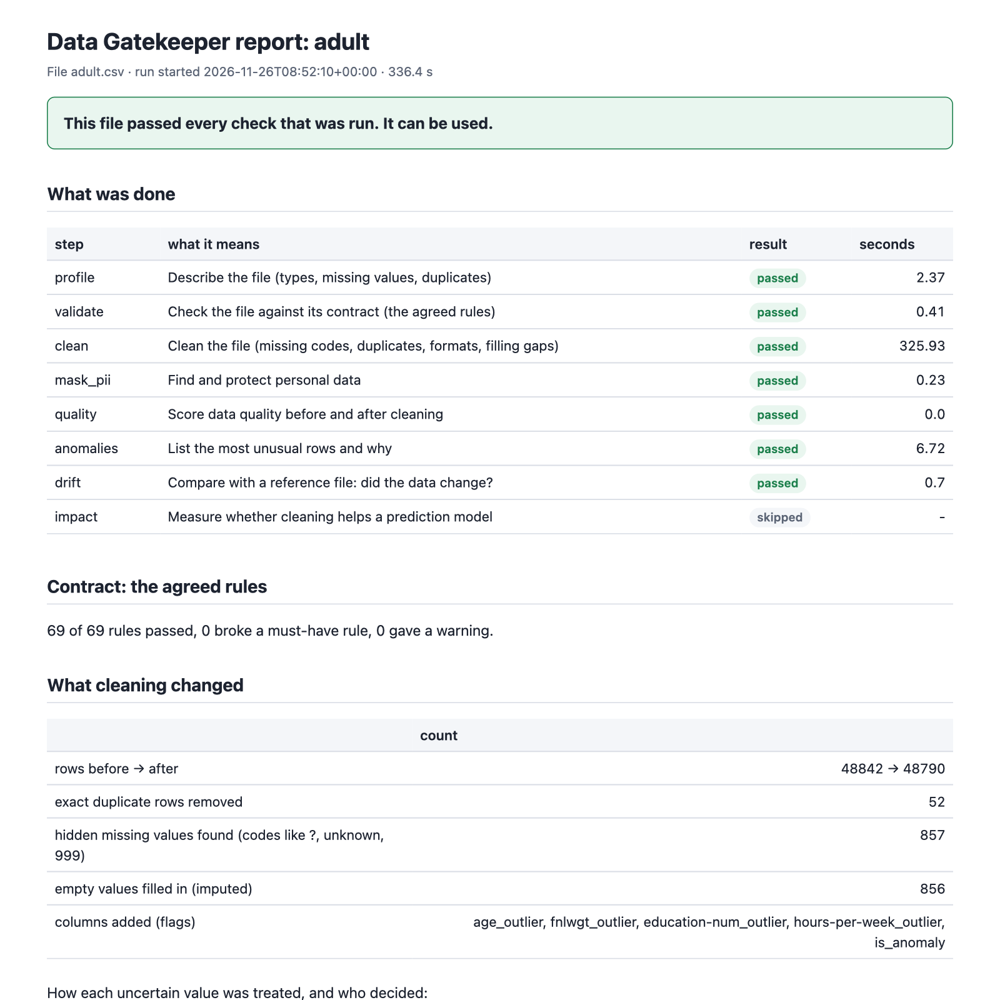

# Sprint 11 Summary — Module 4 part 2: decisions a person can see + a report people can read

**Goal:** turn the Sprint 10 lesson (two automatic choices destroyed signal on UCI Adult) into
decisions a person sees and confirms, make the iterative imputer fast enough, take a first fairness
measurement, and give every run one page a non-technical reader can open.

## What I built
| Feature | Where |
|---|---|
| **Decisions for a person**: "top code or sentinel?" and "informative missing?", each with counts, the label rate in those rows vs the rest, a two-proportion test, today's default and a recommendation | `src/profiling/decisions.py`, `gatekeeper decisions` |
| Decisions set per column in the contract / config (`decisions:`), obeyed by the cleaner, logged with who set them (default vs config) | `src/cleaning/cleaner.py` (`apply_decisions`), `contracts/adult_decisions.yaml` |
| Faster iterative imputer measured by a rule fixed before measuring: the winner (`skip_complete`) became an option, **not** the default, after the robustness check | `src/cleaning/imputers.py` (`ITERATIVE`, `make_iterative`), `scripts/evaluate_imputer_speed.py` |
| Fairness measurement from out-of-fold predictions: group rates, TPR, FPR, ROC-AUC, Wilson intervals, gaps A vs B | `src/impact/fairness.py`, `gatekeeper impact --fairness sex,race` |
| One self-contained HTML page per run (plain-words status, steps, contract, cleaning + decisions, quality warning, anomalies, drift, impact) | `src/pipeline/html.py`, `gatekeeper report`, written by `gatekeeper run` |
| Logging: console + `run.log` (levels, timings per step, no data values) | `src/pipeline/run.py` |
| `POST /run` (CSV + JSON config, time limit) and `GET /runs/{id}/report.html` | `src/api/app.py` |
| Adult transform ablation for LogReg | `scripts/ablate_adult_transform.py` |
| Tests **407 → 440**, all passing; ruff clean | `test_decisions.py`, `test_imputer_default.py`, `test_fairness.py`, `test_report_and_run_api.py` |

## Commands
```bash
python gatekeeper.py decisions data/raw/adult.csv --target income --write draft.yaml
python gatekeeper.py impact data/raw/adult.csv --target income \
       --decisions contracts/adult_decisions.yaml --fairness sex,race --no-robustness
python scripts/evaluate_imputer_speed.py            # speed vs accuracy, rule in the header
python gatekeeper.py run --config pipeline_adult.yaml --skip impact   # writes report.html + run.log
python gatekeeper.py report reports/run_<time>
curl -F file=@data.csv -F config=@config.json http://127.0.0.1:8000/run
python scripts/diagnose_adult_impact.py ; python scripts/ablate_adult_transform.py
```

## Part 1: decisions for a person
**The rule for "clearly different"** was written into `DECISION_RULE` (with the reasons) before any run: the label rate
differs by **more than 5 percentage points**, a two-proportion z-test gives **p < 0.01**, and **at least 30 rows** hold
the value. Without a target only counts are listed.

**UCI Adult** (`gatekeeper decisions data/raw/adult.csv --target income`):

| column | value | question | rows | `>50K` in these rows | in the rest | p | today | recommended |
|---|---|---|---|---|---|---|---|---|
| capital-gain | 99999 | top code or sentinel? | 244 | 100.00% | 23.55% | 1.5e-171 | treat_as_missing | **keep_as_value** |
| workclass | ? | informative missing? | 2,799 | 9.47% | 24.81% | 3.7e-76 | impute | **keep_as_category** |
| occupation | ? | informative missing? | 2,809 | 9.43% | 24.81% | 8.7e-77 | impute | **keep_as_category** |

`native-country = ?` (857 rows, 25.67% vs 23.90%) is **not** listed: it is not clearly different, so imputing it stays.

**The person's choice** (`contracts/adult_decisions.yaml`) follows all three recommendations. The brief expected two
decisions (99999 and `workclass ?`), but the evidence supports three. Every `workclass ?` row also has `occupation ?`
(the 10 extra `occupation ?` rows are `workclass = Never-worked`), so both columns describe the same "no job reported"
group, and treating them differently would be inconsistent.

**Bank Marketing check: does the detector fire wrongly?** (`--target y`) It lists only two values, both already handled:

| column | value | question | rows | `yes` in these rows | in the rest | today | recommended |
|---|---|---|---|---|---|---|---|
| pdays | 999 | top code or sentinel? | 39,673 | 9.26% | 63.83% | special_code | **special_code** (keep the Sprint 4 decision) |
| default | unknown | informative missing? | 8,597 | 5.15% | 12.88% | keep_as_category | keep_as_category |

`pdays = 999` stays the Sprint 4 decision (special code → `previously_contacted`), and the detector says so instead of
recommending a change. `default = unknown` is the Sprint 5 decision, now backed by numbers. The other `unknown` codes
(job, marital, education, housing, loan) are not listed: by the rule, their label rates are not clearly different
from the rest.

**Adult impact WITH the decisions** (`gatekeeper impact data/raw/adult.csv --target income --decisions
contracts/adult_decisions.yaml --fairness sex,race --no-robustness`; same 5 folds and seed as Sprint 10; run alone with
`OPENBLAS_NUM_THREADS=1`, 816.1 s; robustness was not re-run on Adult this sprint):

| B − A | Sprint 10 (defaults) | Sprint 11 (with the decisions) |
|---|---|---|
| LogReg ROC-AUC | −0.0093 [−0.0104, −0.0082] worse | **−0.0079 [−0.0090, −0.0068] worse** |
| LogReg PR-AUC | −0.0364 [−0.0386, −0.0342] worse | −0.0325 [−0.0342, −0.0307] worse |
| LogReg Brier ↓ | +0.0057 [+0.0050, +0.0063] worse | +0.0050 [+0.0043, +0.0056] worse |
| HGB ROC-AUC | −0.0053 [−0.0071, −0.0035] worse | **−0.0002 [−0.0005, +0.0002] no clear difference** |
| HGB PR-AUC | −0.0126 [−0.0191, −0.0062] worse | −0.0002 [−0.0014, +0.0009] no clear difference |
| HGB F1 | −0.0103 [−0.0153, −0.0054] worse | +0.0007 [−0.0016, +0.0029] no clear difference |
| HGB Brier ↓ | +0.0032 [+0.0018, +0.0047] worse | +0.0001 [−0.0001, +0.0004] no clear difference |

This run happened while `skip_complete=True` was the imputer default (see Part 2, where that default is withdrawn). It makes
no difference here: B and C are identical (below), and C does not use the iterative imputer at all. So the change from
Sprint 10 is the decisions alone. C − A shows the same: LogReg ROC-AUC −0.0108 → −0.0079, HGB −0.0022 → −0.0002 [−0.0005,
+0.0001]. This is the same as the Sprint 10 ablation's "keep both" row (−0.0079 / −0.0002), which is expected because it is
the same change on the same folds.

**B and C are now identical to 4 decimals on every metric.** With `?` kept as a category and 99999 kept as a number, the
only column left to impute is `native-country` (857 `?`), and on fold 0 the iterative imputer fills all 181 of its gaps in the test rows with `United-States`, the
same as the mode. Not one cell differs from the median/mode imputer, with either imputer setting (`skip_complete` on or
off). So on Adult with these decisions, the imputer choice no longer matters, and the B numbers above hold for the final
default too.

**Honest caveat: this is not an independent test.** The decisions were chosen *after* Sprint 10's ablation on this same
data showed which values hurt. So the gain shows that the decisions remove the damage Sprint 10 found. It does not show
that the detector would find the right decisions on new data. That needs a dataset nobody has looked at yet. The detector
itself uses only the label rates, which any user would see before choosing.

With the decisions, the gatekeeper no longer hurts HistGradientBoosting on Adult. **LogReg still loses −0.0079 ROC-AUC.**
Part 5 looks for the cause. B's fit time per fold fell from 342–390 s (Sprint 10) to 154–159 s.

## Part 2: faster iterative imputation
**The rule was written in the script header and committed before the first measurement** (commit `4c51622`): a candidate is
acceptable when, on both Bank and Adult, the Sprint 5 hidden-10% evaluation shows a mean NRMSE at most 0.02 higher and a
categorical accuracy at most 1.0 point lower than today. The fastest acceptable candidate wins (fit time on CV fold 0 of
Adult). Adult uses the Sprint 11 decisions.

| setting | Bank fit (s) | Bank NRMSE | Bank accuracy | Adult fit (s) | Adult NRMSE | Adult accuracy | acceptable |
|---|---|---|---|---|---|---|---|
| current (max_iter 10, all columns) | 34.8 | 0.4481 | 65.52% | 349.8 | 0.8593 | 69.46% | baseline |
| **skip_complete** | **15.0** | 0.4481 | 65.52% | **140.5** | 0.8593 | 69.46% | **yes → winner** |
| n_nearest_features 15 | 6.3 | 0.4930 | 64.56% | 17.2 | 0.9182 | 73.78% | no (NRMSE +0.0449 / +0.0589) |
| max_iter 5 | 17.4 | 0.4512 | 65.66% | 172.3 | 0.8591 | 69.25% | yes (slower) |
| skip_complete + nearest 15 | 2.9 | 0.4833 | 64.71% | 6.6 | 0.9328 | 75.60% | no (NRMSE +0.0352 / +0.0735) |

Single-threaded BLAS for all rows. `nearest 15` is 20–50× faster and even raises Adult's categorical accuracy, but it fails
the numeric rule on both datasets, so it is not taken. The rule's result is what counts.

**`skip_complete` gives identical accuracy here for a reason worth knowing.** The evaluation hides cells in every column it
scores, so no column is "complete" while the imputer learns. The change only matters when a column had **no gaps in the
training rows but has gaps in new rows**: it is then filled with its training mean instead of a model prediction.
That is exactly what the robustness test does, so it was measured:

Bank robustness, A and B, same seed / folds / levels as Sprints 8–10, `skip_complete=True` (229.9 s; B 25 s per fold
instead of 42–105 s). A is identical in every row. ROC-AUC of B, Sprint 10 → with `skip_complete`:

| corruption | model | 0% | 5% | 10% | 20% |
|---|---|---|---|---|---|
| all kinds | HistGradientBoosting | 0.9503 → 0.9502 | 0.9248 → 0.9124 | 0.8936 → 0.8676 | **0.8126 → 0.7590** |
| all kinds | LogisticRegression | 0.9351 → 0.9351 | 0.9151 → 0.8866 | 0.8889 → 0.8396 | **0.8184 → 0.7365** |
| missing | LogisticRegression | 0.9351 → 0.9351 | 0.9282 → 0.9179 | 0.9220 → 0.9047 | 0.9092 → 0.8740 |
| sentinels | HistGradientBoosting | 0.9503 → 0.9502 | 0.9415 → 0.9375 | 0.9333 → 0.9249 | 0.9141 → 0.8972 |
| duplicates | both | unchanged | unchanged | unchanged | unchanged |

Clean data is unchanged, but on dirty new rows `skip_complete` gives back a large part of the gatekeeper's best-measured
advantage. Most Bank columns have no gaps in the train rows, so they get no model.

**Decision: the default stays `skip_complete=False`.** The rule written before measuring picked `skip_complete`, and I
report that. But the rule's accuracy test could not see this case, and the robustness study shows the loss is not small.
Keeping the old default was decided **after** seeing the robustness result. That is a correction of what the evaluation
missed, not a re-tuned threshold, and the rule and its outcome are kept unchanged in the script. `skip_complete` stays
available (`ITERATIVE["skip_complete"] = True`) for clean data where speed matters. With the final default, **Adult B time
per fold stays at the Sprint 10 level (342–390 s)**; with `skip_complete` it was 154–159 s in the Adult impact run above.
A faster option that keeps a model for every column (for example fewer, better-chosen features per model) is a Sprint 12
item.

## Part 3: a first fairness measurement on Adult (measurement only)
From the same Adult run: out-of-fold predictions (each row predicted once, by a model that never saw it), pooled over the
5 folds, threshold 0.5. A group is *small* (flagged, left out of the gaps) with fewer than 50 positives or 50 negatives;
that limit was set before the run. `sex` and `race` are used as ordinary features, exactly as before. Nothing here changes
a model.

**sex** (Female 16,192 rows, 10.93% `>50K`; Male 32,650 rows, 30.38%):

| model | variant | Female TPR [95% CI] | Male TPR [95% CI] | Female FPR | Male FPR | ROC-AUC F / M | TPR gap | FPR gap | predicted positive gap |
|---|---|---|---|---|---|---|---|---|---|
| LogReg | A raw | 0.5110 [0.4877, 0.5343] | 0.6165 [0.6068, 0.6260] | 0.0213 | 0.0982 | 0.9331 / 0.8823 | 0.1055 | 0.0769 | 0.1808 |
| LogReg | B gatekeeper | **0.4624 [0.4393, 0.4857]** | 0.6091 [0.5995, 0.6187] | 0.0232 | 0.1049 | 0.9250 / 0.8739 | **0.1467** | 0.0817 | 0.1868 |
| HGB | A raw | 0.5811 [0.5580, 0.6039] | 0.6663 [0.6569, 0.6755] | 0.0180 | 0.0822 | 0.9481 / 0.9110 | 0.0852 | 0.0642 | 0.1801 |
| HGB | B gatekeeper | 0.5806 [0.5574, 0.6034] | 0.6668 [0.6574, 0.6760] | 0.0177 | 0.0818 | 0.9488 / 0.9106 | 0.0862 | 0.0641 | 0.1803 |

**race** (gaps over 5 groups; none is small, but Amer-Indian-Eskimo has 55 positives and Other 50, so their intervals are
wide):

| model | variant | TPR gap | FPR gap | predicted positive gap | ROC-AUC gap | lowest TPR (group, 95% CI) |
|---|---|---|---|---|---|---|
| LogReg | A raw | 0.2783 | 0.0907 | 0.1975 | 0.0521 | 0.3818 Amer-Indian-Eskimo [0.2652, 0.5139] |
| LogReg | B gatekeeper | 0.3570 | 0.0876 | 0.2019 | 0.0537 | 0.2909 Amer-Indian-Eskimo [0.1877, 0.4214] |
| HGB | A raw | 0.1503 | 0.0709 | 0.1661 | 0.0576 | 0.5091 Amer-Indian-Eskimo [0.3808, 0.6362] |
| HGB | B gatekeeper | 0.1584 | 0.0687 | 0.1678 | 0.0549 | 0.5091 Amer-Indian-Eskimo [0.3808, 0.6362] |

**Does the gatekeeper's cleaning make group gaps bigger or smaller than raw?**
- **HistGradientBoosting: no meaningful change.** Every gap moves by less than 0.01 (sex TPR gap +0.0010, race +0.0081).
- **LogisticRegression: bigger, for sex.** The TPR gap between women and men grows from 0.1055 to 0.1467. Women's TPR drops
  by 0.049 while men's drops by 0.007, and the women's intervals before and after do not overlap. So the lower overall
  LogReg score under the gatekeeper falls mostly on women who earn `>50K`. For race the LogReg TPR gap also grows
  (0.2783 → 0.3570), but that comes from the Amer-Indian-Eskimo group with 55 positives, whose intervals overlap widely.
  It is not a reliable finding.

Plain-words caveats: this measures the models' *behaviour*, not whether they are fair. The groups have very different base
rates (10.93% vs 30.38%), so equal TPRs and equal predicted-positive rates cannot both be reached. The census categories
for `race` are coarse. Measuring is a first step, and nothing was mitigated.

## Part 4: a report people can read
`gatekeeper run` now writes `report.html` and `run.log` into every run folder; `gatekeeper report <run_dir>` rebuilds the
page. It is one self-contained file (inline CSS and SVG; no script, font, image or link that loads anything), with every
text escaped. It reads only the reports a run already wrote, which never contain raw PII values. The tests check this on
the fake-PII customers file. It prints cleanly (`@media print`).

Order on the page: the status as one plain sentence ("This file passed every check that was run. It can be used." /
"This file was STOPPED …" / "The run did not finish …"), what was done (every step in words), the contract, **what cleaning
changed and who decided each uncertain value** (the person / the default), the decisions for a person, quality before /
after **with the warning that a higher quality score is not a better model**, the most unusual rows with reasons, drift,
and the impact headline.

Real run: `gatekeeper run --config pipeline_adult.yaml --skip impact` passed (exit 0, 336.4 s). The decisions from
`contracts/adult_decisions.yaml` were applied (cleaning log: 3 set by config, `native-country ?` by default), so only
857 codes became missing (6,709 without the decisions). The quality score went 99.74 → **99.80**, not 100.00 as in
Sprint 10. Keeping meaningful codes lowers the score while it helps the model, which is exactly what the warning on the
page says.



**A bug this run found:** the first Adult pipeline run showed `decisions_from_config: none`, and 6,709 codes were still
imputed. With `imputer: iterative` in the clean step, the config was rebuilt and the confirmed decisions were silently
dropped. It is fixed, with a regression test (`test_pipeline_clean_applies_decisions_together_with_an_imputer`), and the
run above is the corrected one.

`POST /run` takes a CSV and a JSON config (steps profile / validate / clean / mask_pii / quality / anomalies; a
contract by name from `contracts/`), runs `gatekeeper run` in a separate process with a 120 s limit (504 after that), and
returns the summary with a link to `GET /runs/{id}/report.html`, or the page itself with `?output=html`. The upload is
written to a private temporary folder deleted after the run; data files and the cleaning log are removed from the
server's run folder, so only reports remain. Logging goes to the console and `run.log`: levels, one line per step with its
status and seconds, errors by type only, never a data value.

## Part 5: LogReg transform ablation on Adult
`scripts/ablate_adult_transform.py`: same CV, A raw vs C (median imputer), **with** the confirmed decisions, one Sprint 6
transform choice switched off at a time. Only a diagnosis; the shipped transform is unchanged.

| transform | LogReg ROC-AUC C − A | LogReg PR-AUC C − A | HGB ROC-AUC C − A |
|---|---|---|---|
| as shipped | −0.0079 [−0.0090, −0.0068] | −0.0325 [−0.0342, −0.0307] | −0.0002 [−0.0005, +0.0001] |
| **no power transform** (skewed columns only scaled) | **−0.0002 [−0.0004, +0.0001]** | −0.0003 [−0.0008, +0.0003] | −0.0002 [−0.0005, +0.0002] |
| no "infrequent" grouping (all 41 countries) | −0.0078 [−0.0089, −0.0067] | −0.0323 [−0.0346, −0.0299] | −0.0001 [−0.0004, +0.0002] |
| both off | +0.0000 [−0.0000, +0.0001] | −0.0001 [−0.0003, +0.0001] | −0.0001 [−0.0004, +0.0002] |

**The power transform (log1p / Yeo-Johnson on skewed columns) causes the whole remaining LogReg gap.** Without it, LogReg
with the gatekeeper is as good as raw (CI includes 0). Grouping rare countries costs nothing. The trees do not care either
way. I did not check which skewed column is responsible; Adult's skewed columns include `capital-gain` and `capital-loss`
(91.74% / 95.33% zeros). I did **not** change the transform default after seeing this: that needs a test on more than this
one dataset (on Bank, LogReg gained PR-AUC with the gatekeeper in Sprint 8, possibly from this transform, which was
never ablated there), so it is a Sprint 12 decision.

## Honest conclusion
- **The decisions work, with an honest caveat.** The detector found exactly the values Sprint 10's ablation blamed
  (99999, `?` in workclass/occupation), with clear evidence. With a person's confirmation, the damage to
  HistGradientBoosting on Adult is gone (B − A −0.0053 → −0.0002). On Bank it fires only on values already handled. This
  is not an independent test, because the decisions were informed by the same data.
- **The last LogReg gap on Adult is the power transform**, not the cleaning. With both decisions and no power transform,
  the gatekeeper no longer hurts either model on Adult. On Bank the gatekeeper gave LogReg a PR-AUC gain that may come from
  the same transform (not ablated), so the right default needs both datasets measured.
- **Faster imputation: the measured winner was not safe.** `skip_complete` had the same in-table accuracy and was 2.5×
  faster, but it cost up to 0.08 ROC-AUC on dirty new rows, where the gatekeeper is most useful. It stays an option; the
  default is unchanged. A pre-set rule is only as good as what it measures.
- **Fairness: the cleaning leaves HGB's group gaps alone but widens LogReg's TPR gap between women and men**
  (0.1055 → 0.1467). This is measured, not mitigated.
- **The pipeline can now be read by a person:** one HTML page per run, a `run.log`, and the same over HTTP
  (`POST /run`). The Adult pipeline run found a real bug: the confirmed decisions were silently dropped when an
  imputer was also set. It is fixed, with a regression test.

## Limitations
- The Adult decisions and the LogReg transform finding come from the data Sprint 10 already examined: neither is an
  independent test.
- The decision detector needs a target to judge "informative"; without one it only lists counts. It only looks at codes the
  profiler already flagged (placeholders and 999-style numbers), not at every possible top code.
- The fairness measurement uses one threshold (0.5), two attributes, and groups as the census defines them. Two race groups
  have only 50–55 positives. Nothing is mitigated, and the robustness study was not repeated on Adult with the decisions.
- The HTML report shows what the reports hold. It hides PII because those reports never contain raw PII values, so a new
  report section must follow the same rule. The screenshot is made with macOS Quick Look.
- `POST /run` runs synchronously with a 120 s limit and no queue; it does not offer `drift`, `impact` or `clean.decisions`.
  The upload is written to a temporary folder (deleted after the run), unlike the other endpoints.
- The faster imputer is still open: Adult B remains about 6 minutes per fold with the default.

## Next steps (Sprint 12)
- **Transform default by evidence:** measure the power transform on Bank and Adult (and per column) before changing it;
  then re-check the LogReg fairness gap.
- **Faster imputation that keeps a model per column** (e.g. fewer, well-chosen features per model; or iterative only for
  columns that had gaps anywhere) with the same pre-set rule **plus** the robustness study as a second gate.
- `clean.decisions` and `drift` over HTTP with server-side named files; a small job queue for longer `POST /run` runs.
- Final demo (Module 4): end-to-end on both datasets with the Docker image, the HTML report as the main deliverable,
  the final presentation and recorded demo.
