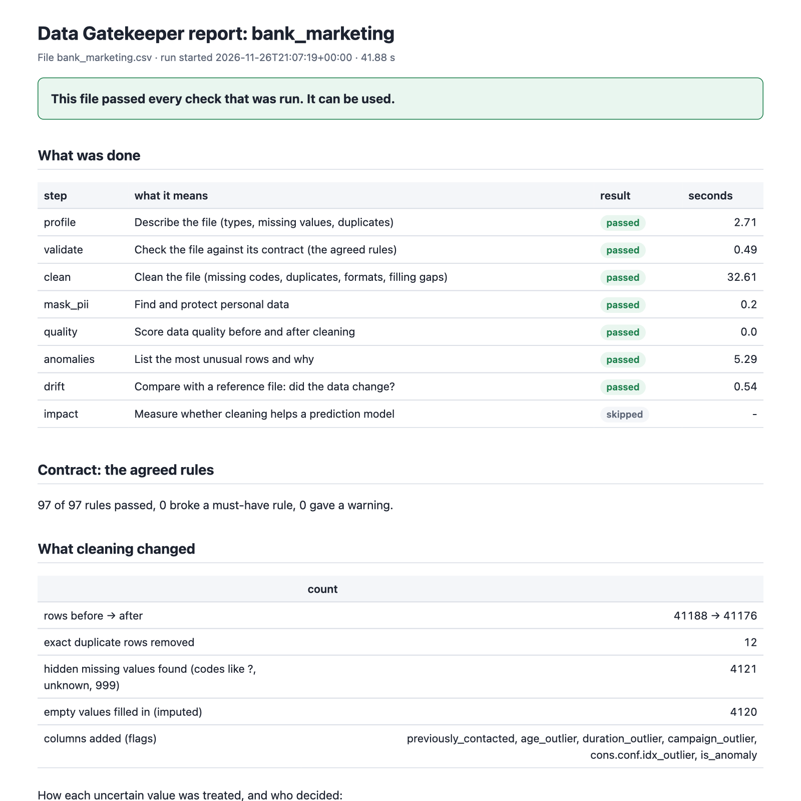

# Sprint 12 Summary — the final sprint: transform by evidence, one-command demo, final docs

**Goal:** close the last open technical question (should skewed columns get a power transform?), make the whole
system run with one command on both datasets, check that the documentation still matches the code, and release
v2.0.0.

## What I built
| Feature | Where |
|---|---|
| Per-column power-transform switch (`POWER`, `power_allowed`) and an ablation decided by a rule written first | `src/transform/plan.py`, `scripts/ablate_power_transform.py` |
| **New default: skewed columns are only scaled** (power transforms opt-in) | `src/transform/plan.py` |
| `make demo` / `scripts/demo.sh`: Docker image (if installed) → downloads with checksums → pipeline on Bank and Adult → two reports; `--full`, `--fixture`, `--local` | `scripts/demo.sh`, `Makefile`, CI Docker job |
| Bank downloader checks a pinned zip SHA-256 (as the Adult one does) | `scripts/download_bank_marketing.py` |
| Docs checker: commands parsed or run, links, README numbers vs sprint reports, plan status | `scripts/check_docs_commands.py` |
| Independent test of the decision detector on a new dataset (UCI Mushroom), criteria fixed before download | `scripts/independent_decision_test.py` |
| `docs/architecture.md`, `docs/final_presentation.md`, `docs/demo_script.md`, a new README top section | `docs/`, `README.md` |
| Tests **440 → 449**, all passing; ruff clean | `test_transform.py`, `test_demo.py`, `test_check_docs.py` |

## Commands
```bash
make demo                                   # = bash scripts/demo.sh (Docker if installed)
bash scripts/demo.sh --fixture --local      # no network, two committed files (the CI smoke test)
python scripts/ablate_power_transform.py    # the transform rule, in its header
python scripts/independent_decision_test.py
python scripts/check_docs_commands.py
```

## Part 1: the power transform, decided by evidence
**The rule was written in the script header and committed before the first run** (commit `34f43f7`):
1. Compare "all off" (skewed columns only scaled) with "all on" (as shipped), as the paired fold difference of the C
   variant (cleaning + median imputer + transform; 5-fold CV, seed 42).
2. The power transform stays ON only if, on **both** Bank and Adult, turning it off makes LogisticRegression ROC-AUC or
   PR-AUC worse with a 95% CI excluding 0.
3. Otherwise the default becomes "scale only", but only if HistGradientBoosting is not hurt (no "off − on" CI
   entirely below 0 on either dataset).
4. One-column-at-a-time rows explain; they decide nothing (no per-column rule was written before measuring).

Step 0 logged the skewed columns before any model was trained (fold 0 train rows): Bank `duration, campaign, previous,
nr.employed`; Adult `fnlwgt, capital-gain, capital-loss`. Bank as in Sprint 8 (no decisions); Adult with
`contracts/adult_decisions.yaml`.

**Bank Marketing**

| setting | model | ROC-AUC C − A | PR-AUC C − A | ROC-AUC vs all on | PR-AUC vs all on |
|---|---|---|---|---|---|
| all on | LogReg | −0.0001 [−0.0020, +0.0017] | +0.0200 [+0.0109, +0.0292] | – | – |
| all on | HGB | −0.0003 [−0.0009, +0.0002] | +0.0017 [−0.0020, +0.0053] | – | – |
| **all off** | LogReg | −0.0001 [−0.0004, +0.0003] | +0.0009 [−0.0015, +0.0033] | +0.0001 [−0.0017, +0.0018] | **−0.0191 [−0.0280, −0.0102]** |
| all off | HGB | −0.0003 [−0.0009, +0.0002] | +0.0017 [−0.0020, +0.0053] | +0.0000 [+0.0000, +0.0000] | +0.0000 [+0.0000, +0.0000] |
| only duration off | LogReg | −0.0000 [−0.0004, +0.0003] | +0.0008 [−0.0019, +0.0034] | +0.0001 [−0.0017, +0.0018] | −0.0192 [−0.0283, −0.0102] |
| only campaign off | LogReg | −0.0002 [−0.0020, +0.0016] | +0.0198 [+0.0102, +0.0295] | −0.0001 [−0.0001, +0.0000] | −0.0002 [−0.0009, +0.0005] |
| only previous off | LogReg | −0.0001 [−0.0020, +0.0017] | +0.0198 [+0.0100, +0.0296] | −0.0000 [−0.0000, +0.0000] | −0.0002 [−0.0009, +0.0005] |
| only nr.employed off | LogReg | −0.0001 [−0.0020, +0.0018] | +0.0201 [+0.0104, +0.0298] | +0.0000 [−0.0001, +0.0001] | +0.0001 [−0.0008, +0.0009] |

HGB is identical to "all on" in every single-column row (differences +0.0000). The full table is in
`reports/power_ablation.json`.

**UCI Adult (with the confirmed decisions)**

| setting | model | ROC-AUC C − A | PR-AUC C − A | ROC-AUC vs all on | PR-AUC vs all on |
|---|---|---|---|---|---|
| all on | LogReg | −0.0079 [−0.0090, −0.0068] | −0.0325 [−0.0342, −0.0307] | – | – |
| all on | HGB | −0.0002 [−0.0005, +0.0001] | −0.0002 [−0.0014, +0.0009] | – | – |
| **all off** | LogReg | −0.0002 [−0.0004, +0.0001] | −0.0003 [−0.0008, +0.0003] | **+0.0077 [+0.0067, +0.0088]** | **+0.0322 [+0.0301, +0.0343]** |
| all off | HGB | −0.0002 [−0.0005, +0.0002] | −0.0002 [−0.0014, +0.0010] | +0.0000 [−0.0000, +0.0000] | +0.0000 [−0.0000, +0.0001] |
| only fnlwgt off | LogReg | −0.0080 [−0.0091, −0.0069] | −0.0325 [−0.0346, −0.0304] | −0.0001 [−0.0002, +0.0000] | −0.0000 [−0.0004, +0.0003] |
| only capital-gain off | LogReg | −0.0005 [−0.0006, −0.0003] | −0.0014 [−0.0020, −0.0008] | +0.0074 [+0.0064, +0.0084] | +0.0311 [+0.0289, +0.0332] |
| only capital-loss off | LogReg | −0.0075 [−0.0086, −0.0065] | −0.0310 [−0.0328, −0.0292] | +0.0004 [+0.0003, +0.0004] | +0.0015 [+0.0013, +0.0016] |

**The rule, applied exactly:**
- **Bank:** turning the power transform off **hurts** LogReg PR-AUC (−0.0191, CI below 0), and the one-column rows
  show it all comes from `duration`. This answers Sprint 8's open question: the LogReg PR-AUC gain of the gatekeeper on
  Bank (+0.0197) was the power transform on `duration`.
- **Adult:** turning it off **helps** LogReg (ROC-AUC +0.0077, PR-AUC +0.0322), almost all through `capital-gain`
  (91.74% zeros).
- **Rule 2** needs "off hurts on both", which does not hold, and **rule 3** is satisfied (HGB unchanged everywhere).
  → **Decision: skewed columns are only SCALED by default** (`POWER["default"] = False`; opt back in with `True`).

**What this costs, said plainly:** on Bank, LogReg's PR-AUC advantage from cleaning (+0.0200) mostly disappears
(+0.0009, CI includes 0). A per-column rule, for example "no power transform for columns that are mostly zeros", would
keep `duration` transformed and leave `capital-gain` alone. That rule fits both datasets, but it was **not** written
before measuring, so it is not used; it is the first item in "what I would do next".

## Fairness and performance re-check on Adult (final defaults)
`gatekeeper impact data/raw/adult.csv --target income --decisions contracts/adult_decisions.yaml --fairness sex,race
--no-robustness --variants A,B` (same folds and seed; 920.8 s; B 174–202 s per fold):

| B − A | Sprint 11 (power transform on) | Sprint 12 (skewed columns only scaled) |
|---|---|---|
| LogReg ROC-AUC | −0.0079 [−0.0090, −0.0068] worse | **−0.0002 [−0.0004, +0.0001] no clear difference** |
| LogReg PR-AUC | −0.0325 [−0.0342, −0.0307] worse | **−0.0003 [−0.0008, +0.0003] no clear difference** |
| HGB ROC-AUC | −0.0002 [−0.0005, +0.0002] | −0.0002 [−0.0005, +0.0002] |
| HGB PR-AUC | −0.0002 [−0.0014, +0.0009] | −0.0002 [−0.0014, +0.0010] |

**With the confirmed decisions and the final transform default, the gatekeeper no longer hurts either model on Adult.**

| TPR gap (max − min over groups) | A raw | B, Sprint 11 | **B, Sprint 12** |
|---|---|---|---|
| sex, LogReg | 0.1055 | 0.1467 | **0.1053** |
| sex, HGB | 0.0852 | 0.0862 | 0.0862 |
| race, LogReg | 0.2783 | 0.3570 | **0.2577** |
| race, HGB | 0.1503 | 0.1584 | 0.1584 |

**Does LogReg's TPR gap for sex close? Yes.** Women's TPR is back at 0.5110 [0.4877, 0.5343] (Sprint 11 with the
gatekeeper: 0.4624), and men's is 0.6163, so the gap with the gatekeeper (0.1053) is the raw gap (0.1055). In
Sprint 11 the gatekeeper's extra gap came from the same transform that cost LogReg its overall score. For race the
LogReg gap is now a little *smaller* than raw (0.2577 vs 0.2783), but it still rests on groups with 50–55 positives and
wide intervals. HGB is unchanged by the transform (it was already unchanged by the cleaning). Measurement only: the gaps
between women and men exist in the raw data and in both models; nothing was mitigated.

## Robustness re-check on Bank (final defaults)
`gatekeeper impact data/raw/bank_marketing.csv --target y --variants A,B` (same seed, folds and levels as Sprints 8–11;
174.3 s). A is identical to Sprint 10 in every row. ROC-AUC of B, Sprint 10 → Sprint 12:

| corruption | model | 5% | 10% | 20% |
|---|---|---|---|---|
| all kinds | HistGradientBoosting | 0.9248 → 0.9248 | 0.8936 → 0.8935 | 0.8126 → 0.8125 |
| all kinds | LogisticRegression | 0.9151 → 0.9134 | 0.8889 → 0.8862 | 0.8184 → 0.8168 |
| sentinels | HistGradientBoosting | 0.9415 → 0.9415 | 0.9333 → 0.9333 | 0.9141 → 0.9141 |
| sentinels | LogisticRegression | 0.9287 → 0.9280 | 0.9218 → 0.9208 | 0.9065 → 0.9046 |
| numbers as text | LogisticRegression | 0.9292 → 0.9284 | 0.9230 → 0.9214 | 0.9118 → 0.9081 |
| missing | LogisticRegression | 0.9282 → 0.9279 | 0.9220 → 0.9208 | 0.9092 → 0.9070 |

- **HistGradientBoosting:** no regression, identical to 4 decimals except one row (−0.0001).
- **LogisticRegression is slightly lower** under corruption (−0.0003 to −0.0037), and on clean folds its PR-AUC drops
  0.6193 → 0.6004 (ROC-AUC 0.9351 → 0.9352). That is the Bank cost the transform rule accepted. The gatekeeper's lead
  over raw on dirty data is unchanged in size: at 20% mixed corruption LogReg still scores 0.8168 against raw 0.5081.
- B − A on clean Bank folds: LogReg ROC-AUC −0.0000 [−0.0004, +0.0003], PR-AUC +0.0010 [−0.0013, +0.0032]; HGB +0.0001 /
  +0.0020, all with CIs that include 0.

## Part 2: the final demo
`OPENBLAS_NUM_THREADS=1 PYTHON=python make demo` on the development machine: **Docker is not installed here**, so the
script printed `!! Docker is not installed here: running the same commands LOCALLY with python` and ran the same
commands locally. The Docker path is covered by CI. Every push builds the image and runs `scripts/demo.sh --fixture`
inside it (a new step of the Docker job), next to the earlier `validate` and `gatekeeper run` checks in the container.

Real run, exit 0, **287 s in total** (4 min 47 s):

| step | result |
|---|---|
| downloads | Bank `bank_marketing.csv` SHA-256 `74adfc57…`, Adult `adult.csv` `6f8f2bab…` (both zips matched their pinned hashes); Adult split 32,561 / 16,281 |
| drift reference | `bank_reference.csv` 28,831 rows, `bank_current.csv` 12,357 rows (seed 42) |
| Bank pipeline | **passed, exit 0, 41.88 s**: 41,188 rows, 2 decisions for a person, contract 97 / 97, 41,188 → 41,176 rows, 4,121 hidden missing → 4,120 imputed, quality 98.48 → 98.60, 412 anomalies (1%), drift: no major column |
| Adult pipeline | **passed, exit 0, 238.63 s**: 3 decisions for a person, all 3 applied from `contracts/adult_decisions.yaml`, contract 69 / 69, 48,842 → 48,790 rows, quality 99.74 → 99.80, 489 anomalies, drift: no major column |
| reports | `reports/run_20261126-210719/report.html` (Bank), `reports/run_20261126-210803/report.html` (Adult) |



`make demo-full` adds the impact study (A / B / C, 5 folds, robustness) on both datasets. It was not run as one command:
its parts were run separately in this sprint (Adult A / B fairness 920.8 s, Bank robustness 174.3 s), and the full
A / B / C run with robustness took 2,050.5 s (about 34 minutes) on Adult in Sprint 10.

## Part 3: the docs check
`python scripts/check_docs_commands.py` over README.md and all 22 files in `docs/`: **exit 0, 0 failed checks.**

| check | ok | skipped | failed |
|---|---|---|---|
| commands in ```bash blocks | 38 | 35 | 0 |
| relative links | 53 | 5 (external, not tried offline) | 0 |
| 4-decimal numbers in the README found in a sprint report / presentation | 23 | – | 0 |
| sprints marked ✅ in `docs/sprint_plan.md` | 12 | – | 0 |

The 38 commands were all `gatekeeper.py` commands checked against the real argument parser, with the quick ones on
committed files actually run (reports sent to a temporary folder), plus `--help` of the scripts that have one. The 35
skipped ones need something the checker cannot provide: a running server (12 `curl`), Docker (3), make / pytest / pip /
bash / source run by CI (7), a server or environment setup (`uvicorn`, `export`, the PII salt variable, `python -m venv`: 4),
and 9 commands running scripts without `--help` that would start a full measurement (only checked to exist).

**The checker found five real problems while it was being built**, all fixed before the result above:
- Scripts without `--help` would have run in full. One measurement started before a timeout stopped it, so now they
  are never executed.
- Placeholder file names (`new.csv`, `data.csv`) were run as if real; they are now parsed only.
- A joined continuation line left a double space and weakened de-duplication.
- The checker ran itself with `--help`, recursively. Detection now needs `import argparse`, and the checker answers
  `--help` itself.
- Sprint 12 was not yet ✅; that is fixed by this release.

## Part 4 (optional): faster imputation that keeps a model for every column
**Not done.** The time went to the transform question and the demo. The Sprint 11 finding stands: the faster
`skip_complete` setting passed the accuracy rule but failed on dirty data, so the default is unchanged (about 6 minutes
per Adult fold).

## Part 5 (optional): an independent test of the decision detector
Sprint 11 could not test the detector independently. Here, **UCI Mushroom** (8,124 rows, never used in this project;
target `class`, positive = poisonous, 48.20%). Its description file documents `?` as the missing code. The success
criteria were committed before the download (commit `1bb9b5c`): run the detector on a random half A (seed 42), and a
listed decision holds up only if half B, which the detector never saw, shows a clearly different label rate in the same
direction.

| | rows with `stalk-root = ?` | poisonous in these rows | in the rest | difference | p | clearly different |
|---|---|---|---|---|---|---|
| half A (detector) | 1,214 | 71.25% | 39.04% | +32.21 points | 7.6e-79 | yes → recommended `keep_as_category` |
| half B (check) | 1,266 | 70.70% | 37.34% | +33.36 points | 1.6e-86 | **yes, same direction** |

**Outcome: SUCCESS** by the criteria written first: 1 decision listed, 1 holds up. Honest limits: one dataset and one
decision. It shows the *evidence* is stable on unseen rows, not that keeping `?` as a category improves a model there
(not measured). The profiler found no other code in this dataset.

## Honest conclusion
- **The last open technical question is answered by evidence, and the answer has a cost.** The rule written first
  turned power transforms off by default. On Adult this removes the last damage the gatekeeper did: LogReg B − A
  −0.0079 → −0.0002, and LogReg's TPR gap between women and men goes back to raw (0.1467 → 0.1053). On Bank it removes
  the one gain cleaning gave LogReg: PR-AUC +0.0200 → +0.0009 (CI includes 0), now explained as the transform on
  `duration`. A per-column rule would likely keep both, but it was not written before measuring, so it is the first
  thing to do next, not something to slip in now.
- **Nothing regressed for the trees;** LogReg is 0.0003–0.0037 lower under corruption on Bank and still far above raw
  (0.8168 vs 0.5081 at 20% mixed corruption).
- **The decision detector passed an independent test.** On a dataset nobody had looked at, its one finding held up on
  rows it never saw.
- **One command runs the system on both datasets** (287 s here, locally because Docker is not installed on this
  machine; CI runs the same demo inside the image), and **the docs check passes** with every README number traced to a
  sprint report.
- **Over the whole project:** cleaning is not automatically good. Data Gatekeeper's measured value is robustness on dirty
  data and showing a person what to decide. Its quality score says what changed, not whether the change was right.

## Limitations
- The transform default rests on two datasets. The "scale only" choice costs Bank's LogReg PR-AUC, and a per-column rule
  is untested.
- Optional Part 4 (a faster imputer that keeps a model for every column) was not done; the Adult B fold still takes
  about 3–6 minutes.
- `make demo` was run locally (Docker not installed here). The Docker path is covered by CI's fixture demo inside the
  image, not by a full-data run in a container. `make demo-full` was not run as one command.
- The independent detector test is one dataset with one decision, and it measured the evidence, not a model gain.
- The docs checker skips commands that need a server, Docker or a secret, and does not try external links offline;
  `--online` does.
- The fairness work is a measurement of two attributes at one threshold; nothing is mitigated.
