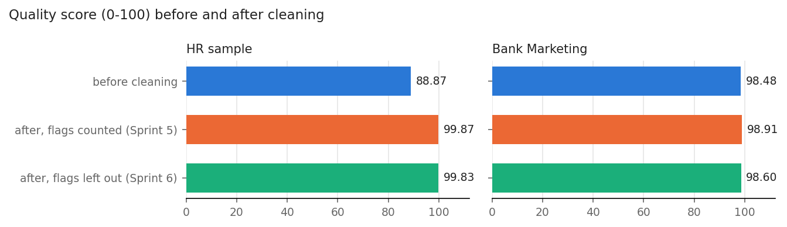

# Sprint 6 Summary — Module 2 part 3: transformation, PII masking, API

**Goal:** finish Module 2.
- Make the quality score honest.
- Turn cleaned data into model-ready numbers without data leakage.
- Find and protect personal data.
- Offer the whole module over HTTP.

## What I built
| Feature | Where |
|---|---|
| Quality score leaves cleaning's flag columns out (scored apart) | `src/quality/score.py` |
| Per-column encoding, power transform and scaling, each with a written reason | `src/transform/plan.py` |
| `ColumnTransformer` fitted on train only, joblib save/load, `transform_report.json` | `src/transform/pipeline.py`, `run_transform.py` |
| PII detection: 9 types by column name + content (regex, Luhn), confidence | `src/privacy/detect.py` |
| mask / salted hash (HMAC-SHA256, salt from env) / drop / generalize + `pii_report.json` | `src/privacy/mask.py`, `run_masking.py` |
| Fake PII dataset (300 customers, reserved test ranges only) | `scripts/make_sample_data.py` |
| API: `/health`, `/profile`, `/clean`, `/transform`, `/mask-pii`; size/row limits, no stack traces | `src/api/app.py`, `make api` |
| Charts + Module 2 presentation summary | `docs/figures/`, `docs/module2_summary.md` |
| Tests **167 → 219**, all passing; ruff clean and now run in CI | `tests/` |

## New files, in one line each (for the mentor)

**Transform:**
- `src/transform/plan.py` looks at each column of the *train* rows and decides how to turn it into numbers, writing down why. For example: "skew 3.19 → Yeo-Johnson; 0% outliers → standard scaler".
- `src/transform/pipeline.py` turns that plan into one scikit-learn pipeline. It splits first, fits on train only, transforms test, and saves the fitted pipeline so new data gets exactly the same treatment.

**Privacy:**
- `src/privacy/detect.py` finds personal-data columns from two clues: the column name and how the values look. It returns a type and a confidence, never a value.
- `src/privacy/mask.py` protects each PII column with one of five actions and writes a report of what was done.

**API:**
- `src/api/app.py` is one FastAPI app for the whole module. It checks every upload (CSV only, size, rows) and never shows a stack trace.

**Scripts and CLIs:**
- `scripts/make_figures.py` draws the presentation charts from the real result files.
- `run_transform.py` and `run_masking.py` are the command-line versions.

## Results
| | Bank Marketing | HR sample | Fake customers |
|---|---|---|---|
| Quality after cleaning, old → **fixed** score | 98.91 → **98.60** | 99.87 → **99.83** | – |
| Train / test rows | 32,940 / 8,236 | 406 / 102 | – |
| Columns in → model columns out | 26 → 63 | 9 → 16 | – |
| Skewed columns fixed (skew before → after) | duration 3.19 → 0.17, campaign 4.89 → 0.37 | salary 8.87 → 1.16 | – |
| PII columns found | 0 | 3 | 9 / 9 |
| Transform time | 1.1 s | 0.1 s | – |

## What I learned
1. **A score can look better for the wrong reason.** The flag columns are always filled, so adding them raised completeness. The honest Bank score is lower (98.60), and that is the right number to report.
2. **Leakage is easy to cause and easy to test.** If the scaler sees the test rows, the model's test score lies. The test checks `scaler.n_samples_seen_ == len(train)`.
3. **One rule does not fit every column.** `log1p` made the left-skewed `nr.employed` worse, and Yeo-Johnson overflowed on 9,999,999 salaries. Trying both, keeping the better one, and standardising first fixed both problems.
4. **Privacy needs tests, not intentions.** One test compares every masked cell with its original. Another makes sure an error message containing an email never reaches the client.
5. **A hash without a secret is not private.** Anyone can hash a list of known emails and compare the codes. The salt (from an environment variable, never in the code) prevents that, and it still lets two tables be joined.

## Plan for Module 3 (Sprints 7–9)
- Validate new files against `schema.json`: types, ranges, allowed values, formats.
- Anomaly detection and drift checks between a reference file and new data.
- Carry-over: faster iterative imputation on big files, `--imputer auto`, date features in the transform.
